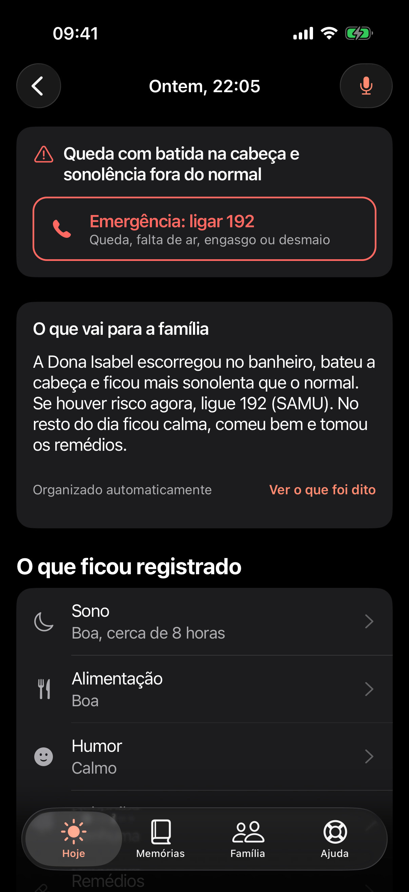
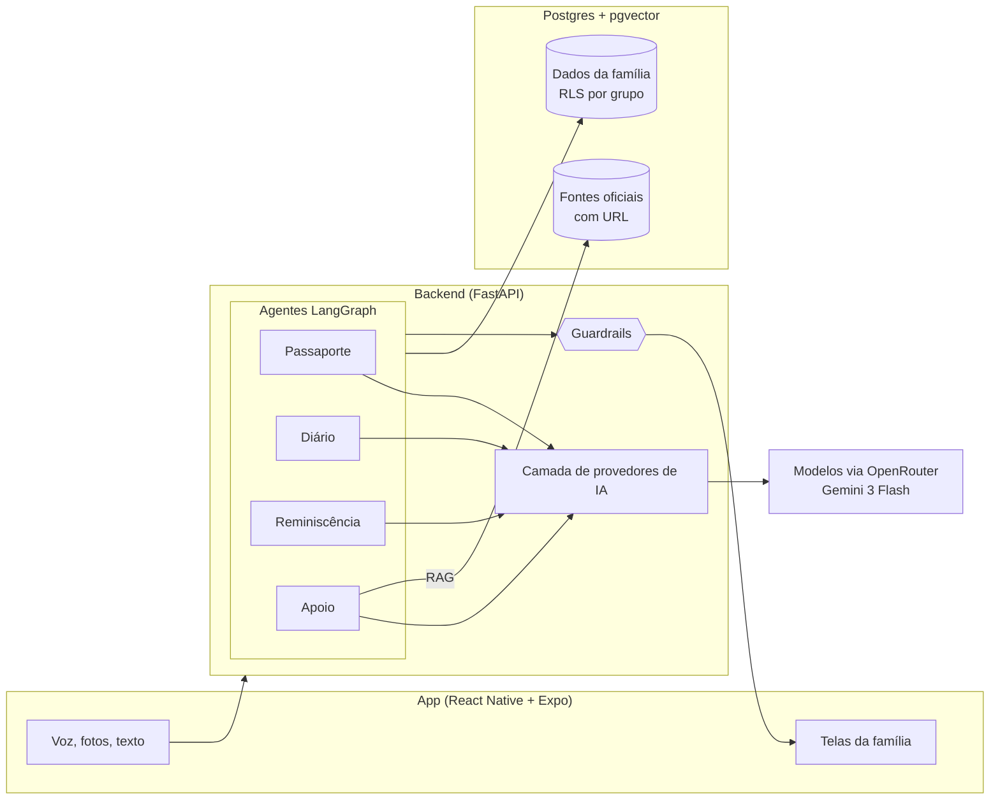

<p align="center">
  
</p>

<p align="center">
  <b>SempreAqui é uma plataforma de IA que aproxima famílias em torno do cuidado de quem vive com Alzheimer, preservando a história da pessoa e garantindo que ninguém cuide sozinho.</b>
</p>

<p align="center">
  <a href="LICENSE">Licença MIT</a> ·
  <a href="docs/etica-e-seguranca.md">Ética e segurança</a> ·
  <a href="docs/avaliacao.md">Avaliação da IA</a> ·
  <a href="docs/roadmap.md">Roadmap</a>
</p>

---

Projeto inscrito no **AI4Good da Brazil Conference 2027 at Harvard & MIT**, tema *"IA que aproxima: unindo pessoas, eliminando barreiras e fortalecendo o pertencimento da sociedade brasileira"*.

## O problema

Cerca de **2 milhões de brasileiros** vivem com demência, e esse número deve **triplicar até 2050**. Quem segura o cuidado é a família:

- **86%** de quem cuida são mulheres, e **45%** têm sintomas de ansiedade ou depressão.
- O cuidado consome em média **mais de 10 horas por dia**.
- O cuidado informal feito pela família responde por **pelo menos 73% dos custos** da demência.

Os números vêm do Relatório Nacional sobre a Demência no Brasil, do Ministério da Saúde. Detalhes e fontes em [docs/problema.md](docs/problema.md).

Por trás dos números, o padrão se repete. Uma filha concentra tudo. Os irmãos que moram longe querem ajudar, mas não sabem como nem o que está acontecendo. Nas consultas, ninguém lembra direito como foram as últimas semanas. E aos poucos a pessoa deixa de ser vista como alguém com história, gostos e jeito próprio, e passa a ser vista só como paciente.

## A solução

O SempreAqui é um app de celular, pensado para ser usado por voz, que faz três coisas: guarda quem a pessoa é, organiza o dia a dia do cuidado e divide esse cuidado com a família.

| Função | O que faz | Onde a IA entra |
|---|---|---|
| **Passaporte de Memória** | A família manda áudios, fotos e textos sobre a pessoa. Sai um perfil com como ela gosta de ser chamada, história, pessoas importantes, rotina, músicas, comidas, o que acalma, o que agita e como se comunica. Gera link somente leitura e PDF de uma página para cuidadores, centro-dia ou hospital. | IA multimodal transcreve e extrai de áudios, fotos e textos soltos um perfil estruturado |
| **Conversas de Reminiscência** | Sessões de 5 a 10 minutos com uma foto, música ou lembrança e perguntas abertas e gentis para a família conduzir. Nunca "você lembra?". Registra como a pessoa reagiu. | Gera roteiros personalizados a partir do Passaporte e aprende com as reações |
| **Diário Inteligente** | Quem cuida grava um áudio contando o dia. Sai um registro de sono, alimentação, humor, agitação, episódios e medicação, um resumo semanal para a família e uma lista objetiva "Para levar na consulta". | Transcreve, extrai campos estruturados e compara com o habitual da própria pessoa |
| **Apoio na Hora Difícil** | Quem cuida descreve a situação ("ela está agitada e quer ir embora") e recebe o que costuma funcionar para aquela pessoa. Dúvidas gerais são respondidas com fontes oficiais e link. Em risco, orienta ligar 192 e avisa a família. | Agente cruza Passaporte e Diário, e RAG sobre fontes oficiais |
| **Rede da Família** | Grupo com papéis, divisão de tarefas (consultas, visitas, cobrir a folga de quem cuida), lembretes e um feed com os resumos. | Os resumos da IA viram o feed que mantém todos por perto |

<p align="center">
  
  
  
  
</p>

<p align="center"><sub>Telas rodando no iPhone (iOS 26). Família fictícia, retratos gerados por IA. Todas as telas, em modo claro e escuro, estão em <a href="design/screens">design/screens</a>.</sub></p>

## Por que IA

Quem cuida não tem tempo de preencher formulário. Tem tempo de mandar um áudio de dois minutos no fim do dia, do mesmo jeito que manda para a irmã no WhatsApp. A IA é o que transforma esse áudio desorganizado em informação útil: um registro estruturado, um resumo carinhoso para quem mora longe, uma comparação com as semanas anteriores e uma lista objetiva para o médico.

Sem IA, o SempreAqui seria mais um app de anotações que ninguém atualiza. Com IA, o esforço de quem cuida continua sendo só falar, e toda a família passa a enxergar o cuidado.

## Princípios

- **A IA não diagnostica e não dá orientação médica.** Ela organiza, resume, aponta mudanças em relação ao habitual da própria pessoa e encaminha. Nunca sugere remédios ou doses, nunca diz que algo é "sinal de piora".
- **Fontes oficiais, sempre com link.** Toda informação geral de saúde vem de materiais do Ministério da Saúde, ABRAz e outras fontes públicas reconhecidas.
- **Guardrails testados, não só pedidos no prompt.** Todo texto voltado à família passa por uma verificação automática. Se a IA errar duas vezes, a família recebe um resumo montado sem IA. Risco sempre gera orientação de ligar 192.
- **LGPD de verdade.** Consentimento explícito por finalidade, dados isolados por grupo familiar no próprio banco (Row Level Security), nada de dado real em logs, exportar e apagar tudo com um toque.
- **Linguagem respeitosa.** "Pessoa que vive com Alzheimer", "quem cuida", "família". Nunca "paciente", "fardo" ou "peso".
- **Acessível para quem está cansada.** Voz como entrada principal, fontes grandes, alto contraste, botões grandes.

Tudo isso está detalhado em [docs/etica-e-seguranca.md](docs/etica-e-seguranca.md).

## IA no próprio celular

A direção do SempreAqui é rodar a IA **dentro do celular de quem cuida**, com a nuvem só como reserva. Hoje o Diário já funciona sem internet: o áudio fica guardado no aparelho e é enviado sozinho quando a conexão volta. O próximo passo é transcrever e organizar o relato no próprio aparelho.

Os ganhos:

- **O áudio nunca sai do celular.** A transcrição e a extração acontecem no aparelho, e só o registro organizado é compartilhado com a família. É a forma mais forte de cumprir a LGPD: minimização de dados (art. 6º, III) e menos dado sensível de saúde (art. 11) trafegando ou guardado por terceiros.
- **Nenhum provedor de IA vê a vida da família.** Sem envio para modelos externos, não há risco de os dados serem usados para treinar modelos nem de vazarem num serviço de fora.
- **Custo de IA perto de zero.** O que mais custa hoje é mandar áudio para um modelo na nuvem. Rodando no aparelho, isso some, e o app pode continuar gratuito para as famílias.
- **Funciona sem internet de verdade.** O resultado aparece na hora, mesmo no interior, no hospital ou com o plano de dados acabado.

Como vai funcionar:

| Etapa | iPhone | Android | Reserva |
|---|---|---|---|
| Transcrição | Reconhecimento de fala da Apple, no aparelho (iOS 26) | Whisper pequeno rodando local | Modelo na nuvem via OpenRouter |
| Organizar o relato | Modelo local da Apple, com saída presa ao formato do registro | Modelo aberto pequeno (Gemma ou Qwen) | Modelo na nuvem via OpenRouter |
| Guardrails | Regras determinísticas no próprio app | Regras determinísticas no próprio app | As mesmas regras no backend |

A troca só acontece com evidência: o modelo local precisa passar nas mesmas avaliações do Diário, com risco detectado em 3 de 3 casos e zero violações de guardrail. Se não passar, o celular cuida da transcrição e a nuvem fica só com os relatos que exigem mais cuidado. Aparelhos sem suporte continuam usando a nuvem, com os mesmos guardrails.

## Arquitetura



Cada função é um grafo LangGraph com etapas pequenas e verificáveis. O do Diário já funciona: transcreve, extrai um JSON validado com Pydantic, avalia risco, resume e revisa com guardrails. Decisões e detalhes em [docs/arquitetura.md](docs/arquitetura.md).

## Stack

| Camada | Tecnologia |
|---|---|
| App | React Native com Expo (TypeScript) e Expo Router. Roda no celular pelo Expo Go |
| Backend | Python, FastAPI |
| Orquestração de IA | LangGraph, um grafo por função |
| Modelos | Gemini 3 Flash via OpenRouter (escolhido por benchmark próprio de transcrição), atrás de uma camada de provedores trocável por configuração. Só provedores que não guardam dados |
| RAG | Embeddings e pgvector, com fonte e URL em cada trecho |
| Banco | Postgres com Row Level Security por grupo familiar (local via Docker ou Supabase) |
| Qualidade | pytest, ruff, avaliações próprias e CI no GitHub Actions |

## Experimente

Precisa do [uv](https://docs.astral.sh/uv/), do Node 22+ e de uma chave do [OpenRouter](https://openrouter.ai/keys).

**Backend e família de demonstração:**

```bash
cp .env.example .env               # preencha OPENROUTER_API_KEY
bash scripts/instalar-hooks.sh     # bloqueia commits com chaves
cd backend
uv sync
uv run python -m demo.seed         # Dona Isabel, Cláudia e Rafael, com relatos de exemplo
uv run uvicorn api.main:app --host 0.0.0.0 --port 8000
```

**App** (instale o Expo Go no celular, na mesma rede Wi-Fi do computador):

```bash
cd app
npm install
npx expo start          # escaneie o QR code com o Expo Go
```

O app encontra o backend sozinho, pelo mesmo IP do Metro. Grave um relato, veja a IA organizar, corrija um campo e ouça o áudio original.

**Prova de conceito pela linha de comando:**

```bash
uv run --project backend python poc/diario_poc.py --todos
```

Veja [poc/README.md](poc/README.md).

**Banco:** o projeto usa Supabase (Postgres, pgvector, Storage e RLS). Com as variáveis do Supabase no `.env`, `uv run python -m db.migrar` cria tudo. Sem elas, o backend usa um SQLite local e funciona igual.

**Testes e avaliações:**

```bash
cd backend
uv run pytest
uv run python -m evals.avaliar_guardrails
uv run python -m evals.avaliar_diario
uv run python -m evals.comparar_transcricao google/gemini-3-flash-preview
```

Métricas anônimas de uso, incluindo a taxa de correção dos campos da IA: `curl localhost:8000/metricas` ([docs/metricas.md](docs/metricas.md)).

## Como medimos a IA

Cada etapa tem métrica e gabarito versionados: taxa de erro de palavras da transcrição, acurácia por campo do Diário, detecção de episódios e de risco, e zero violações de guardrail no texto que a família recebe. O conjunto adversarial de guardrails roda no CI.

O primeiro benchmark com modelos reais mudou uma decisão: o modelo que usávamos inventava o começo de um relato e perdia uma queda, o que apagaria o alerta de 192. Trocamos para o que transcreve com 3,4% de erro e capta a queda sempre. Na prática, a família também avalia a IA: cada campo corrigido vira dado, e a taxa de correção é acompanhada semana a semana. Metodologia e resultados em [docs/avaliacao.md](docs/avaliacao.md).

## Roadmap até o Demo Day

Trabalhamos em ciclos curtos, cada um entregando uma funcionalidade de ponta a ponta no celular.

| Ciclo | Entrega | Estado |
|---|---|---|
| Fase 0 | Documentação, PoC, guardrails com avaliação, app navegável | concluído |
| 1 | Diário redondo: gravação real, offline, correção com um toque, histórico | concluído |
| 2 | Resumo da semana, mudanças de padrão, lista para a consulta em PDF | construído |
| 3 | Passaporte de Memória montado só falando | próximo |
| 4 | Conversas de Reminiscência geradas a partir do Passaporte | |
| 5 | Apoio na Hora Difícil com fontes oficiais e 192 | |
| 6 | Rede da Família: convite, tarefas e "obrigado" | |
| 7 | Polimento, acessibilidade, deploy e roteiro do Demo Day | |
| Em paralelo | IA no próprio celular: transcrição e organização do relato sem sair do aparelho | em estudo |

O que mudou em cada ciclo está no [CHANGELOG](CHANGELOG.md).

Detalhes em [docs/roadmap.md](docs/roadmap.md).

## Objetivos de Desenvolvimento Sustentável

- **ODS 3, Saúde e bem-estar:** bem-estar de quem cuida, consultas mais bem informadas, informação confiável.
- **ODS 5, Igualdade de gênero:** meta 5.4, valorizar o trabalho de cuidado não remunerado e dividi-lo dentro da família. 86% de quem cuida são mulheres.
- **ODS 10, Redução das desigualdades:** inclusão da pessoa que vive com demência como pessoa, acesso gratuito e por voz.

Mais em [docs/ods.md](docs/ods.md).

## Como contribuir

Contribuições são muito bem-vindas, de código a revisão de texto e indicação de fontes oficiais. Leia o [guia de contribuição](CONTRIBUTING.md) e o [código de conduta](CODE_OF_CONDUCT.md). Se você cuida ou cuidou de alguém com demência e quer conversar sobre o projeto, abra uma issue. Sua experiência vale mais que qualquer linha de código.

## Licença

[MIT](LICENSE). Projeto pessoal e independente, de código aberto.
