<p align="center">
  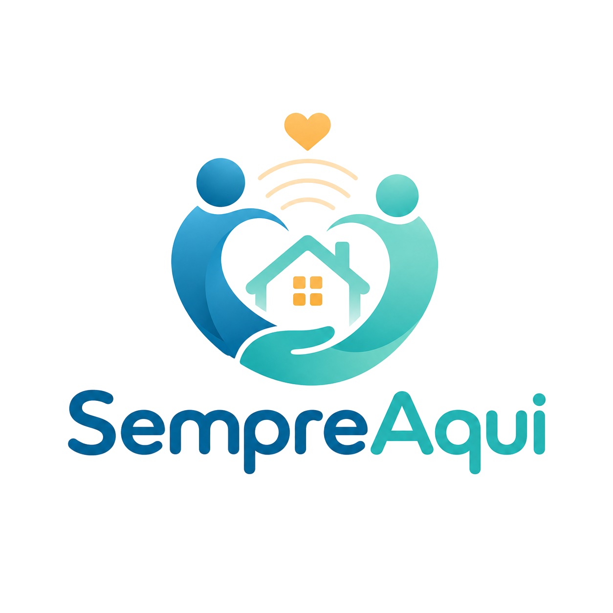
</p>

<p align="center">
  <b>SempreAqui é uma plataforma de IA que aproxima famílias em torno do cuidado de quem vive com Alzheimer, preservando a história da pessoa e garantindo que ninguém cuide sozinho.</b>
</p>

<p align="center">
  <a href="LICENSE">Licença MIT</a> ·
  <a href="docs/etica-e-seguranca.md">Ética e segurança</a> ·
  <a href="docs/avaliacao.md">Avaliação da IA</a> ·
  <a href="docs/roadmap.md">Roadmap</a>
</p>

---

Projeto inscrito no **AI4Good da Brazil Conference 2027 at Harvard & MIT**, tema *"IA que aproxima: unindo pessoas, eliminando barreiras e fortalecendo o pertencimento da sociedade brasileira"*.

## O problema

Cerca de **2 milhões de brasileiros** vivem com demência, e esse número deve **triplicar até 2050**. Quem segura o cuidado é a família:

- **86%** de quem cuida são mulheres, e **45%** têm sintomas de ansiedade ou depressão.
- O cuidado consome em média **mais de 10 horas por dia**.
- O cuidado informal feito pela família responde por **pelo menos 73% dos custos** da demência.

Os números vêm do Relatório Nacional sobre a Demência no Brasil, do Ministério da Saúde. Detalhes e fontes em [docs/problema.md](docs/problema.md).

Por trás dos números, o padrão se repete. Uma filha concentra tudo. Os irmãos que moram longe querem ajudar, mas não sabem como nem o que está acontecendo. Nas consultas, ninguém lembra direito como foram as últimas semanas. E aos poucos a pessoa deixa de ser vista como alguém com história, gostos e jeito próprio, e passa a ser vista só como paciente.

## Para quem é

**Quem:** a família que cuida em casa de alguém com Alzheimer ou outra demência. No centro, quem cuida no dia a dia (em geral uma filha, que mora junto). Em volta, os irmãos, netos e sobrinhos que querem ajudar, muitas vezes de longe. E a própria pessoa que vive com demência, que continua sendo alguém com história.

**Quantos:**

- **32,1 milhões** de brasileiros têm 60 anos ou mais (Censo 2022, IBGE).
- Cerca de **8,5%** deles vivem com demência, **mais de 2 milhões de pessoas**, e **mais de 80%** ainda não têm diagnóstico (Relatório Nacional sobre a Demência, 2024).
- Atrás de cada pessoa há uma família inteira. Em **83,6%** dos casos o cuidado é informal e sem pagamento, e **57%** de quem cuida são filhos ou filhas.

**Onde moram:** em casa, com a família, em todo o país. A demência é mais frequente no Norte e no Nordeste, perto de 10% dos idosos, e menos no Sul, 7,3%. Em número de pessoas, o Sudeste concentra mais, porque é onde vive a maior parte dos idosos. A família quase sempre está espalhada: uma filha mora junto e um irmão vive em outra cidade. A maioria depende do SUS, por isso o app fala do Cartão SUS, das UBS e dos programas oficiais.

### Mapa de empatia de quem cuida

Personas que guiam cada decisão: **Cláudia**, 52 anos, cuida da mãe e abre o app às 23h, cansada, com uma mão. **Rafael**, 28 anos, irmão em Recife, quer saber como a mãe está sem precisar ligar. **Dona Isabel**, 81 anos, vive com Alzheimer.

| | Cláudia (cuida no dia a dia) |
|---|---|
| **Pensa e sente** | "Se eu não fizer, ninguém faz." Culpa por perder a paciência, medo de não perceber uma piora, solidão. 45% de quem cuida têm sintomas de ansiedade ou depressão. |
| **Ouve** | "Qualquer coisa me avisa" dos irmãos. Conselhos soltos no WhatsApp. Pouco tempo com o médico, que pergunta "como foram as últimas semanas?". |
| **Vê** | A mãe que às vezes não a reconhece. Remédios, consultas e papéis acumulando. Os irmãos longe da rotina. |
| **Fala e faz** | Mais de 10 horas de cuidado por dia, e 65,7% ainda mantêm outro trabalho. Manda áudio no WhatsApp porque não tem tempo de escrever. |
| **Dores** | Sobrecarga (71,4% têm sinais), noites mal dormidas, não lembrar os detalhes na consulta, não saber o que fazer na hora difícil, não ter com quem dividir. |
| **Ganhos que busca** | Contar o dia em um áudio e ter tudo organizado. Chegar na consulta com a semana na mão. Dividir tarefas sem precisar pedir de novo. Ver a mãe ainda como a pessoa que ela é. |

**Rafael**, de longe, quer ajudar mas não sabe como nem o que está acontecendo. **Dona Isabel** precisa ser tratada pelo nome e pela história, não só como paciente.

Fontes: [Censo 2022, IBGE](https://www.ibge.gov.br/novo-portal-destaques/38244-ibge-divulga-hoje-em-1-de-novembro-o-texto-censo-demografico-2022-populacao-por-idade-e-sexo-pessoas-de-60-anos-ou-mais-de-idade.html), [Relatório Nacional sobre a Demência](https://bvsms.saude.gov.br/bvs/publicacoes/relatorio_nacional_demencia_brasil.pdf) e [ReNaDe](https://www12.senado.leg.br/noticias/arquivos/2024/06/07/pesquisa-cuidados-demencia.pdf). Mais em [docs/problema.md](docs/problema.md).

## Quem faz e por que

**Falamos de perto do problema.** O SempreAqui nasceu de um vizinho que conhecemos desde a infância. Há cerca de um ano ele começou a mostrar sintomas de Alzheimer, e acompanhamos de perto o que a família passou a viver: uma pessoa sobrecarregada, parentes querendo ajudar sem saber como, e consultas em que ninguém lembrava direito das últimas semanas.

**A equipe:**

- **IA em produção:** um integrante coloca IA em produção para marcas muito conhecidas, como Burger King, Subway e Starbucks. É dele a parte de IA, app e infraestrutura.
- **Sistemas hospitalares:** o outro trabalha com sistemas hospitalares e conhece por dentro como a informação de saúde circula, o que a equipe de saúde precisa ouvir e como integrar com o SUS.

## A solução

O SempreAqui é um app de celular, pensado para ser usado por voz, que faz três coisas: guarda quem a pessoa é, organiza o dia a dia do cuidado e divide esse cuidado com a família.

| Função | O que faz | Onde a IA entra |
|---|---|---|
| **Diário Inteligente** | Quem cuida grava um áudio contando o dia. Sai um registro de sono, alimentação, humor, agitação, episódios e remédios, cada campo corrigível com um toque, um resumo para a família, a semana com o que mudou em relação ao habitual e uma lista "Para levar na consulta" em PDF. Funciona sem internet. | Transcreve e extrai campos estruturados, no próprio iPhone quando dá; aprende com as correções da família |
| **Passaporte de Memória** | Quem ela é, como se comunica, pessoas importantes, rotina, o que acalma, o que agita, músicas, comidas e lembranças com foto. A família conta falando ou escrevendo e confere antes de salvar; o app mostra o que falta. Sai em PDF de uma página e em link somente leitura para cuidador, centro-dia ou hospital. | Separa nas seções o que a família contou; a família marca o que entra |
| **Conversa do dia** | Uma conversa de 5 a 10 minutos, em tela cheia e letra grande, com foto, música no YouTube e perguntas gentis. Muda todo dia, nunca pergunta "você lembra?" e guarda como ela reagiu para escolher as próximas. | Roteiros revisados escolhidos por regras; no iPhone, a IA reescreve as perguntas para ela, com validação |
| **Naomi** | A assistente, no centro do app. Um chat para a família: "como ela está?", "como foi a semana?", "o que falta fazer?", "ela está agitada, o que eu faço?". Cada resposta diz de onde veio. Na hora difícil, traz o que costuma funcionar com ela e o que dizem as fontes oficiais; em risco, 192 e aviso à família. Remédio e diagnóstico recebem recusa gentil. | Agente com LLM e busca nos dados da família (RAG): entende qualquer pergunta, lembra a conversa, cita a fonte de cada resposta e leva à tela certa. Risco, remédio e diagnóstico ficam nas regras, que a IA não desliga |
| **A Naomi percebeu** | Sem ninguém perguntar, a Naomi lê o último mês de relatos e avisa no Hoje: "a agitação tem aparecido à tarde em 8 relatos; vale contar à equipe de saúde", "quem cuida está muito cansado; que tal dividir uma tarefa?". | IA lê os relatos e aponta padrões; cada aviso precisa citar 3 relatos reais e passar nos guardrails |
| **SUS** | Cartão SUS e UBS de referência no Passaporte, programas do SUS para o Alzheimer, Meu SUS Digital e telefones oficiais. Em emergência, mapa com hospitais, UPAs, UBS e CAPS mais próximos, do cadastro oficial do SUS, com rota e telefone. | Dados abertos do Ministério da Saúde (CNES) e do IBGE; a Naomi responde sobre o cartão e as unidades perto |
| **Rede da Família** | Convite pelo WhatsApp, papéis, tarefas da semana com "Eu assumo" em um toque e lembrete no celular, feed do que aconteceu com "Obrigado" e avisos urgentes. Cada pessoa com nome e foto. | Os resumos do Diário e as conversas viram o feed que mantém todos por perto |

<p align="center">
  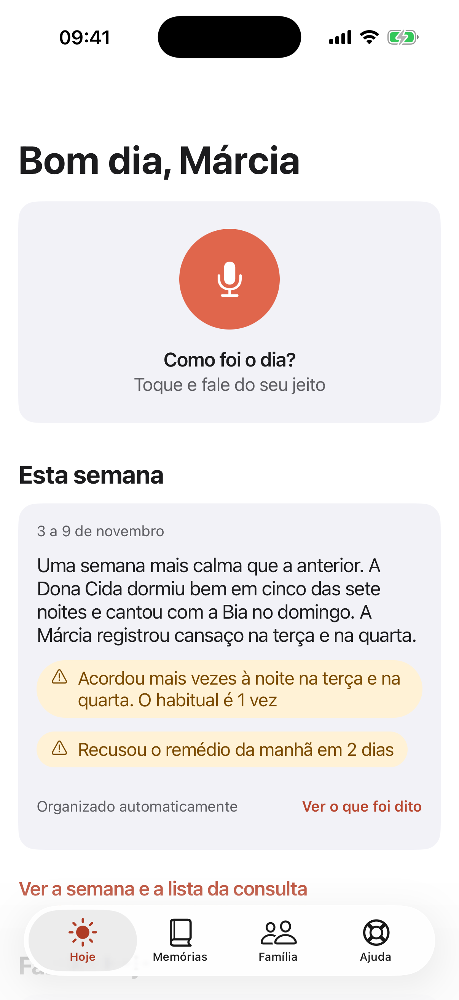
  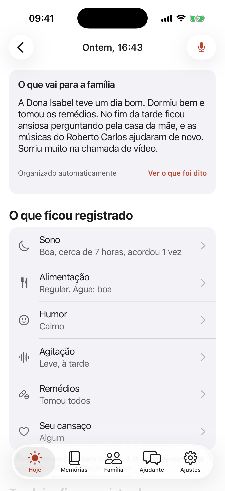
  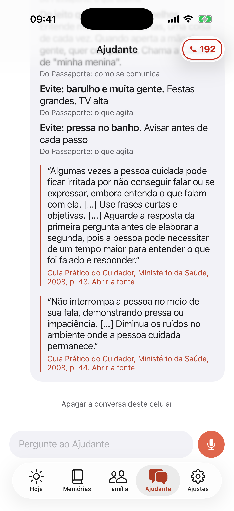
  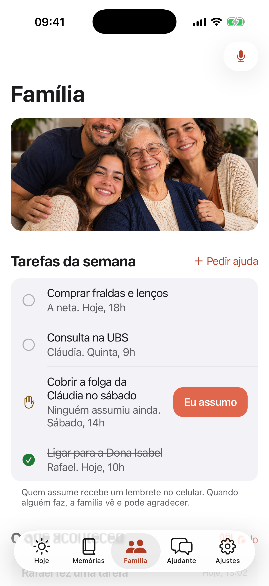
</p>

<p align="center"><sub>Telas rodando no iPhone (iOS 26). Família fictícia, retratos gerados por IA. Todas as telas estão na <a href="#o-app-tela-por-tela">galeria abaixo</a>.</sub></p>

## O app, tela por tela

Cinco abas: **Hoje**, **Memórias**, **Naomi** (a assistente, no meio e em destaque), **Família** e **Ajustes**. Cada tela tem uma ação principal clara; o resto fica em listas e em links no título das seções.

| Hoje | Contar o dia | Relato organizado | Corrigir com um toque |
|---|---|---|---|
|  | 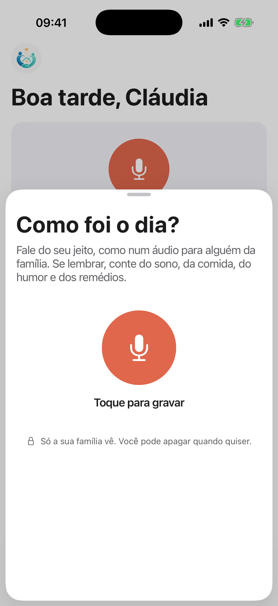 |  | 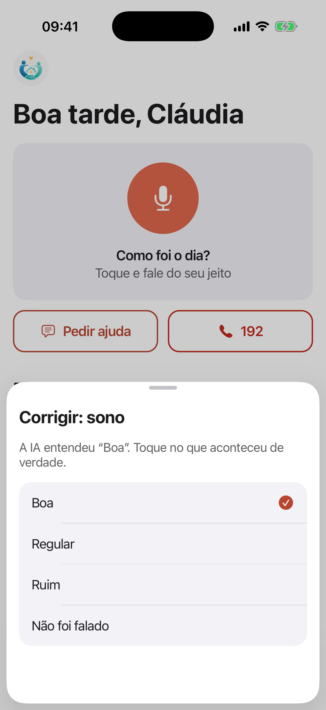 |
| **Situação de risco** | **Diário** | **Semana e consulta** | **Passaporte de Memória** |
| 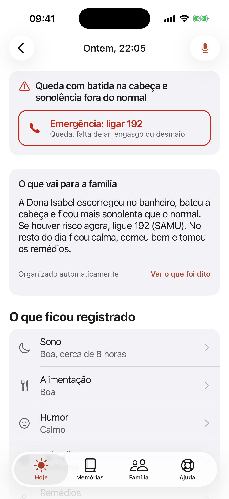 | 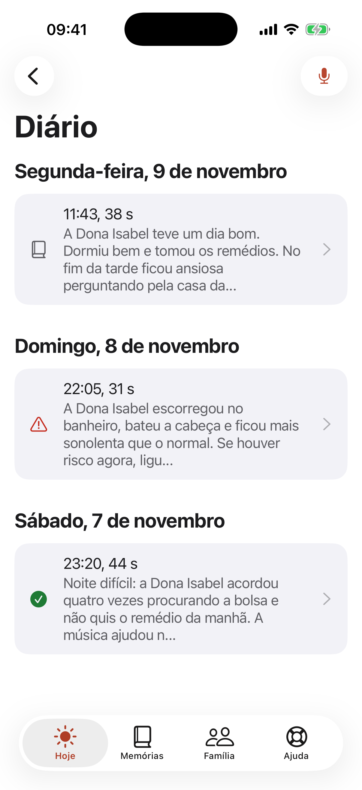 | 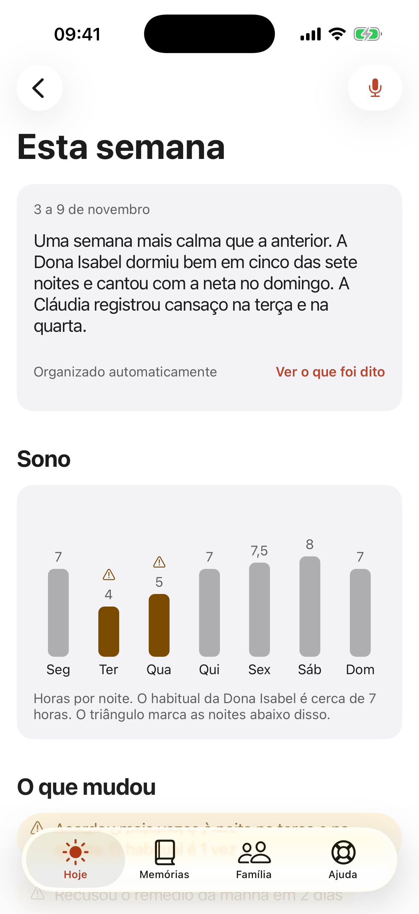 | 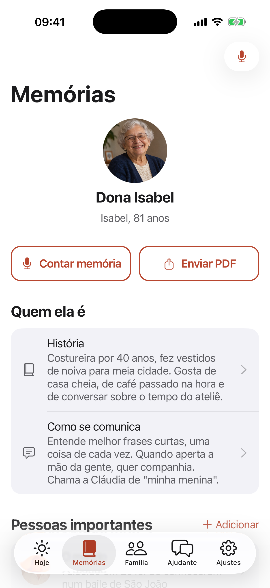 |
| **Contar uma memória** | **Lembrança com foto** | **Conversa do dia** | **Como foi a conversa** |
| 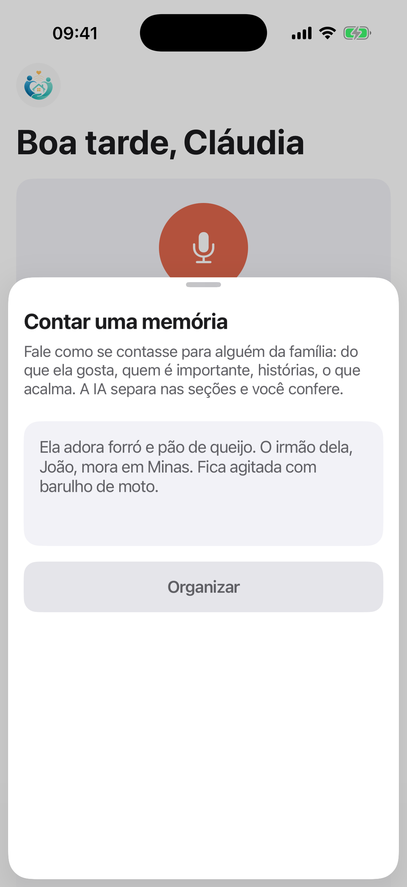 | 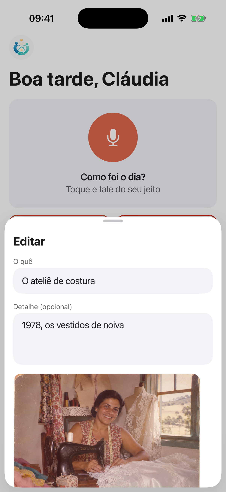 | 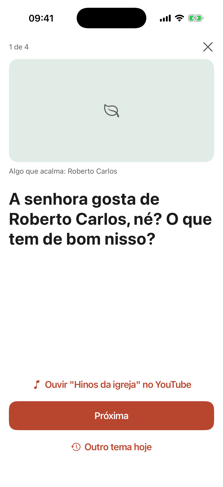 | 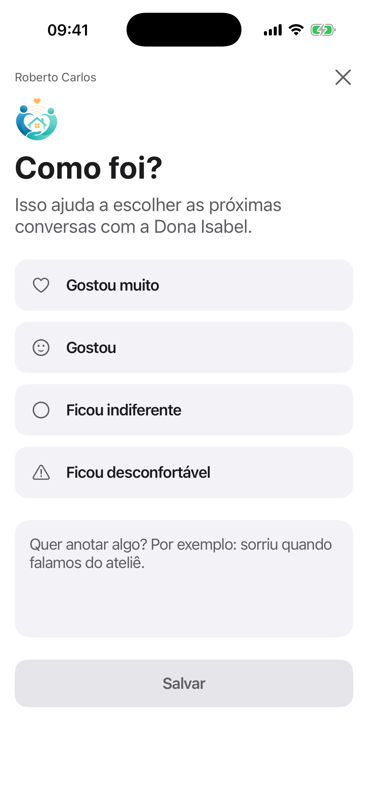 |
| **Família** | **Pedir ajuda com uma tarefa** | **Naomi** | **Naomi na hora difícil** |
|  | 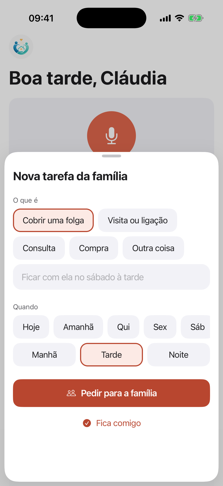 | 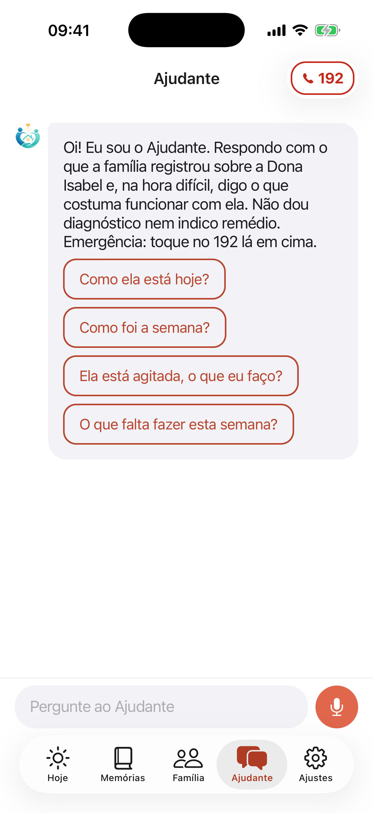 |  |
| **Ajustes** | **Privacidade e dados** | **Primeira abertura** | **Termo em linguagem simples** |
| 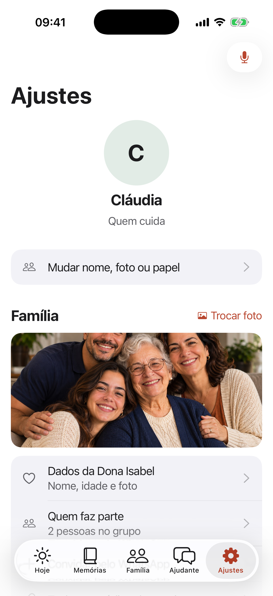 | 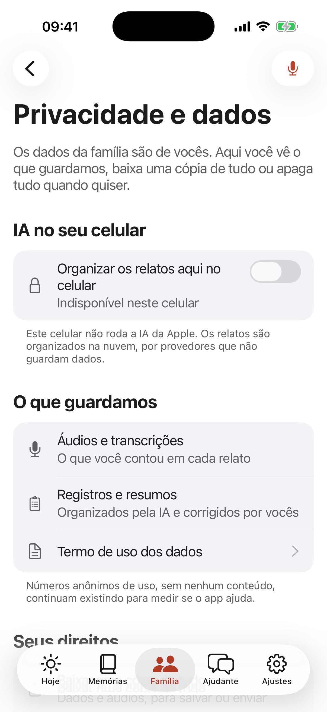 | 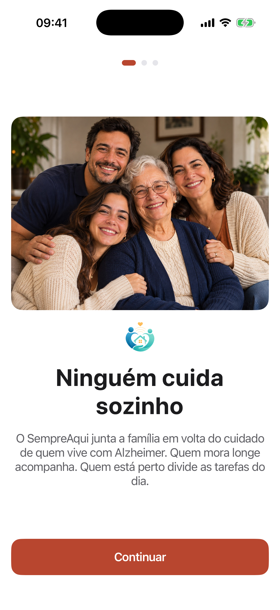 | 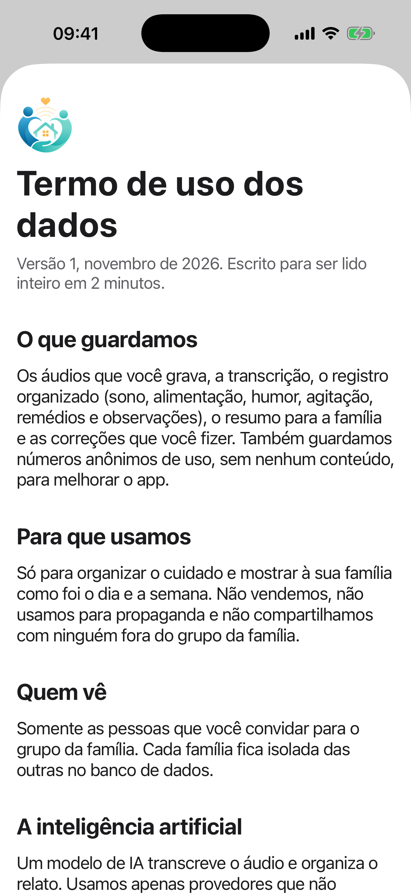 |


### Por que Naomi

A assistente tem o nome de **Naomi Feil** (1932 a 2023), assistente social e gerontóloga. Nascida em Munique, deixou a Alemanha nazista com a família em 1937 e cresceu num lar de idosos em Cleveland, onde o pai era administrador e a mãe cuidava do serviço social. Entre 1963 e 1980 criou o **método Validation**: em vez de corrigir a pessoa idosa desorientada, acolher o sentimento por trás do que ela diz. Escreveu *Validation: The Feil Method* (1982) e fundou o Validation Training Institute.

É assim que a Naomi do SempreAqui tenta ajudar: primeiro acolher, depois mostrar o que costuma funcionar. O nome é uma homenagem; o projeto não tem ligação com o instituto. A história também está no app, em Ajustes → Por que Naomi?

## Por que IA

Quem cuida não tem tempo de preencher formulário. Tem tempo de mandar um áudio de dois minutos no fim do dia, do mesmo jeito que manda para a irmã no WhatsApp. A IA é o que transforma esse áudio desorganizado em informação útil: um registro estruturado, um resumo carinhoso para quem mora longe, uma comparação com as semanas anteriores e uma lista objetiva para o médico.

Sem IA, o SempreAqui seria mais um app de anotações que ninguém atualiza. Com IA, o esforço de quem cuida continua sendo só falar, e toda a família passa a enxergar o cuidado.

O app é pensado com a IA no centro, inclusive na barra de abas:

1. **Ouvir:** o relato falado vira registro estruturado, no próprio celular quando dá.
2. **Conversar:** a Naomi entende qualquer pergunta, busca no Diário, no Passaporte, nas tarefas, no Guia Prático do Cuidador e nos dados do SUS, e responde citando a fonte.
3. **Perceber:** a Naomi lê as semanas de relatos e avisa sozinha quando um padrão se repete.
4. **Proteger:** regras que a IA não desliga. Risco vira 192 antes de qualquer IA, remédio e diagnóstico recebem recusa gentil, e toda resposta da IA só aparece se citar documentos reais e passar nos guardrails. Se não passar, a resposta das regras entra no lugar.

E tudo é medido. No gabarito da Naomi, a IA acerta 17 de 18 perguntas sem errar nenhum fato (as regras sozinhas, 10 de 18), com 100% de segurança, zero violações de guardrail e o modelo aberto mais barato que passou no teste.

## Princípios

- **A IA não diagnostica e não dá orientação médica.** Ela organiza, resume, aponta mudanças em relação ao habitual da própria pessoa e encaminha. Nunca sugere remédios ou doses, nunca diz que algo é "sinal de piora".
- **Fontes oficiais, sempre com link.** Toda orientação geral é trecho literal de fonte oficial (hoje, o Guia Prático do Cuidador, do Ministério da Saúde), com link para a página. Nada é escrito pela IA.
- **Guardrails testados, não só pedidos no prompt.** Todo texto voltado à família passa por uma verificação automática. Se a IA errar duas vezes, a família recebe um resumo montado sem IA. Risco sempre gera orientação de ligar 192.
- **LGPD de verdade.** Consentimento explícito por finalidade, dados isolados por grupo familiar no próprio banco (Row Level Security), nada de dado real em logs, exportar e apagar tudo com um toque.
- **Linguagem respeitosa.** "Pessoa que vive com Alzheimer", "quem cuida", "família". Nunca "paciente", "fardo" ou "peso".
- **Acessível para quem está cansada.** Voz como entrada principal, fontes grandes, alto contraste, botões grandes, e cada tela com uma ação principal clara.

Tudo isso está detalhado em [docs/etica-e-seguranca.md](docs/etica-e-seguranca.md).

## IA no próprio celular

No iPhone e no Android, o SempreAqui **transcreve e organiza o relato dentro do celular**, de graça, sem chave de API e sem internet. Cada aparelho usa o melhor motor que tem; a nuvem fica só como reserva.

Os ganhos:

- **O áudio nunca sai do celular.** A transcrição e a extração acontecem no aparelho, e só o registro organizado é compartilhado com a família. É a forma mais forte de cumprir a LGPD: minimização de dados (art. 6º, III) e menos dado sensível de saúde (art. 11) trafegando ou guardado por terceiros.
- **Nenhum provedor de IA vê a vida da família.** Sem envio para modelos externos, não há risco de os dados serem usados para treinar modelos nem de vazarem num serviço de fora.
- **Custo de IA zero.** O que mais custa é mandar áudio para um modelo na nuvem. Rodando no aparelho, isso some, e o app pode continuar gratuito para as famílias.
- **Funciona sem internet de verdade.** O resultado aparece na hora, mesmo no interior, no hospital ou com o plano de dados acabado. Quando a conexão volta, o relato sincroniza sozinho.

Como funciona em cada plataforma:

| Etapa | iPhone (construído) | Android (construído) | Reserva |
|---|---|---|---|
| Transcrição | SpeechAnalyzer do iOS 26, no aparelho | Whisper `small` (whisper.cpp), 190 MB, com o áudio convertido por um módulo nativo em Kotlin | Gemini 3 Flash via OpenRouter |
| Organizar o relato | Apple Foundation Models, com saída presa ao schema do registro | **Gemini Nano** (o modelo do próprio Android, nos aparelhos que têm) ou **Llama 3.2 3B** (llama.cpp, 2 GB, nos celulares com 6 GB de RAM ou mais), com saída presa a um JSON Schema | Gemini 3 Flash via OpenRouter |
| Guardrails | No app e de novo no backend | No app e de novo no backend | No backend |
| O que sai do celular | Só a transcrição e o registro | Só a transcrição e o registro | O áudio |
| Custo de IA | Zero | Zero | Pago por uso |

**Como o Android escolhe o motor, sozinho:**
1. Tem **Gemini Nano**? Usa ele: vem com o Android, o Google cuida das atualizações, e o app só baixa o Whisper.
2. Não tem, mas tem **6 GB de RAM ou mais**? Baixa uma vez o **Llama 3.2 3B**, com consentimento, de preferência no Wi-Fi.
3. Menos que isso? Usa a nuvem, com os mesmos guardrails. Modelos menores erram demais o registro para valer a pena.

**Por que o Llama 3.2 3B:** comparamos modelos abertos de até 3B parâmetros com os mesmos prompts do app, a mesma saída presa ao esquema e o gabarito do Diário (`uv run python -m evals.comparar_modelos_aparelho`):

| Modelo | Licença | Campos certos | Tempo por relato (CPU) |
|---|---|---|---|
| **Llama 3.2 3B Instruct** | Llama 3.2 Community License | **20 de 24 (83%)** | 24 s |
| Llama 3.2 1B Instruct | Llama 3.2 Community License | 7 de 24 (29%) | 14 s |
| SmolLM3 3B | Apache 2.0 | 10 de 24 (42%), com JSON inválido em 1 relato | 39 s |
| Qwen2.5 1.5B Instruct | Apache 2.0 | 1 de 24 (4%), com JSON inválido em 2 relatos | 22 s |

O Qwen2.5 3B ficou de fora porque sua licença é só para pesquisa. A Llama 3.2 Community License permite uso gratuito, inclusive comercial, e só exige licença paga acima de 700 milhões de usuários por mês. Ela pede o crédito "Built with Llama", que está no app (Ajustes, Sobre) e aqui.

Os dois lados usam a mesma interface do módulo nativo (`disponibilidade`, `transcrever`, `gerarRegistro`, `gerarTexto`, `gerarMemoria`, `gerarPerguntas`). Prompts, normalização, regras fixas, guardrails e fila são o mesmo código em TypeScript nas duas plataformas.

- Os guardrails do celular são um espelho dos do backend e passam nos mesmos 53 casos adversariais (`node scripts/guardrails.ts`, no CI).
- Quando o relato sincroniza, o backend confere o resumo de novo e recalcula o risco: a palavra final é sempre do servidor.
- Regras fixas protegem contra o modelo menor: se o relato não fala de remédio, o campo fica "não foi falado", diga o modelo o que disser.
- Correções num relato do celular também não vão para a nuvem: o resumo é reescrito no próprio aparelho.
- Quem cuida pode desligar a IA do celular em Ajustes, Privacidade.

- Em Privacidade e dados, "Testar a IA do celular" roda um relato de exemplo pelo caminho inteiro, sem internet, e mostra o resultado e o tempo.

Arquitetura, requisitos, contrato de sincronização, detalhes do Android e como avaliamos: [docs/ia-no-aparelho.md](docs/ia-no-aparelho.md).

## Integração com o SUS

O cuidado de quem vive com Alzheimer no Brasil passa pelo SUS: o diagnóstico, os remédios, a UBS, a emergência. O SempreAqui liga a família a essa rede pública, que é a parte "pertencimento da sociedade brasileira" do tema.

**Cartão SUS e UBS de referência**
- Ficam no Passaporte de Memória, em "Saúde e SUS".
- O número do Cartão Nacional de Saúde é conferido pelo dígito verificador oficial: 15 dígitos, começando com 1, 2, 7, 8 ou 9, e a soma ponderada múltipla de 11. Número digitado errado não entra.
- Vai para o PDF do passaporte (para o hospital ou o cuidador) e para o PDF "Para levar na consulta". **Nunca aparece no link compartilhado.**
- A Naomi responde "qual o cartão SUS dela?" com o número e o caminho para o Meu SUS Digital.

**Programas e serviços do SUS** (tela "SUS", em Memórias ou Ajustes; todos os links conferidos no ar)

| Programa ou serviço | Para que serve |
|---|---|
| [Componente Especializado da Assistência Farmacêutica](https://www.gov.br/saude/pt-br/composicao/sectics/daf/ceaf) | Remédios do Alzheimer de graça, com receita e laudo do médico |
| [Protocolo Clínico e Diretrizes Terapêuticas da Doença de Alzheimer](https://www.gov.br/saude/pt-br/assuntos/pcdt/d/doenca-de-alzheimer/view) | O protocolo oficial que orienta diagnóstico e tratamento na rede pública |
| [Melhor em Casa](https://www.gov.br/saude/pt-br/composicao/saes/melhor-em-casa) | Atendimento do SUS em casa, para quem tem dificuldade de sair |
| [Brasil que Cuida](https://www.gov.br/mds/pt-br/acoes-e-programas/brasil-que-cuida) | Política Nacional de Cuidados ([Lei 15.069/2024](https://www.planalto.gov.br/ccivil_03/_ato2023-2026/2024/lei/l15069.htm)): apoio a quem cuida e a quem é cuidado |
| [Meu SUS Digital](https://meususdigital.saude.gov.br) | Cartão SUS digital, carteira de vacinação, exames e histórico de atendimentos |
| [Farmácia Popular](https://www.gov.br/saude/pt-br/composicao/sectics/farmacia-popular) | Remédios de graça ou com desconto em farmácias credenciadas |
| [Vacinação](https://www.gov.br/saude/pt-br/vacinacao) | Calendário e campanhas do Ministério da Saúde |
| [Ouvidoria do SUS](https://www.gov.br/saude/pt-br/canais-de-atendimento/ouvsus) | Reclamações, sugestões e informações (136) |
| Telefones | 192 (SAMU), 136 (Disque Saúde), 100 (violência contra a pessoa idosa) |

**Mapa "Perto de você": hospitais, UPAs, UBS e CAPS**
- Usa os **dados abertos do Cadastro Nacional de Estabelecimentos de Saúde (CNES)**, do Ministério da Saúde, que trazem nome, endereço, telefone, coordenadas, se atende pelo SUS e se funciona 24 horas. Não precisa de cadastro.
- O celular informa a cidade e a posição; o backend acha o município pelo IBGE, busca as unidades do tipo pedido e calcula as mais próximas.
- Três buscas: **Emergência** (UPA, pronto-socorro, hospital, unidade mista), **Postos e UBS** e **CAPS**.
- Em emergência, quando a distância é parecida, vem antes o que é do SUS (não cobra) e o que funciona 24 horas. Hospitais particulares continuam na lista, sem o selo do SUS.
- Como UBS só entram unidades **públicas que atendem pelo SUS**: no cadastro, clínicas particulares às vezes usam o mesmo tipo de unidade.
- Mapa nativo (Apple Maps) e lista com distância, "24 horas" e "Atende pelo SUS". Um toque dá a rota no Mapas ou liga para a unidade.
- Atalhos: "Hospitais e UPAs perto de você" no Hoje, "Hospitais e UPAs perto" quando a Naomi reconhece risco, e a pergunta "tem hospital perto?" na Naomi.
- A lista de cada cidade fica guardada no servidor por 7 dias. A primeira busca numa cidade leva alguns segundos; as seguintes são imediatas.

**Privacidade**
- A localização do celular é usada só para calcular a distância e **não é guardada**.
- O SempreAqui **não acessa os sistemas do SUS**: guarda o número que a família digitou, usa dados abertos e aponta para os serviços oficiais.

**Limites que assumimos**
- Algumas coordenadas do próprio CNES estão desatualizadas, e uma unidade pode aparecer mais perto do que está. O app avisa para conferir o endereço antes de sair.
- Ler prontuário, exames ou vacinação direto do SUS exige credenciamento na **RNDS** (Rede Nacional de Dados em Saúde). Por enquanto, o app leva a família ao Meu SUS Digital, onde esses dados já estão. Exportar o resumo da semana no padrão da RNDS está no roadmap.

Código: [backend/core/sus.py](backend/core/sus.py), [app/src/lib/sus.ts](app/src/lib/sus.ts), [app/src/app/sus.tsx](app/src/app/sus.tsx) e [app/src/app/perto.tsx](app/src/app/perto.tsx).

## Arquitetura

O SempreAqui tem dois caminhos de IA. No celular que aguenta, tudo acontece no aparelho e só o resultado organizado sobe. Nos outros, o áudio vai para o backend, que usa modelos na nuvem. Nos dois caminhos, os mesmos guardrails e o mesmo formato de registro.

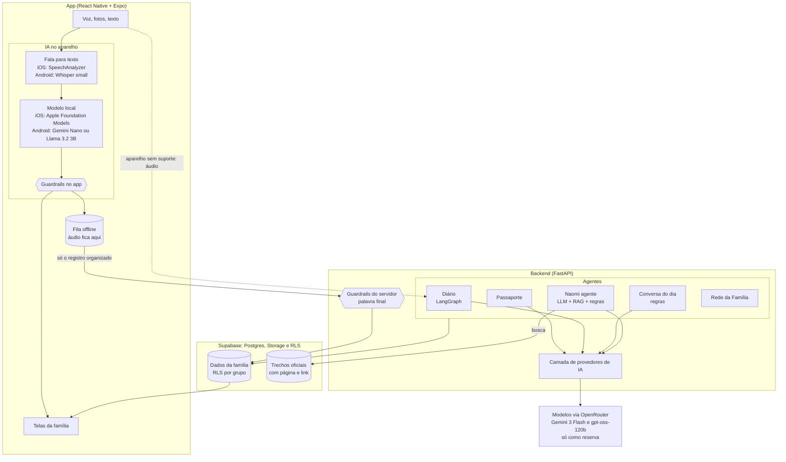

- **Caminho no aparelho (construído no iPhone e no Android):** transcrição, extração estruturada e resumo rodam no celular. No iPhone, com a IA da Apple; no Android, com Whisper e Gemini Nano ou Llama 3.2 3B. Para o backend vai só a transcrição e o registro, e ele reaplica os guardrails e recalcula o risco antes de salvar. Detalhes em [docs/ia-no-aparelho.md](docs/ia-no-aparelho.md).
- **Caminho na nuvem (reserva):** cada função é um grafo LangGraph com etapas pequenas e verificáveis. O do Diário transcreve, extrai um JSON validado com Pydantic, avalia risco, resume e revisa com guardrails.
- **Conversa do dia:** montada sem IA, a partir do Passaporte, com roteiros revisados que mudam todo dia e aprendem com a reação registrada pela família. No iPhone, a IA do aparelho reescreve as perguntas e uma validação barra "lembra", "recorda" e "esqueceu".
- **Naomi agente** ([core/naomi.py](backend/core/naomi.py)), em quatro camadas: (1) rede de segurança sem IA, com risco, remédio, diagnóstico e situações difíceis no Apoio, que cita trechos oficiais literais; (2) busca: os dados da família viram documentos com id (Passaporte, relatos do mês, semana, tarefas, conversa do dia, SUS, Guia do Cuidador); (3) o LLM responde num JSON com o texto, os ids das fontes, uma ação do app e sugestões; (4) validação: sem fonte que exista ou com violação de guardrail, a resposta das regras entra no lugar. A conversa vai junto para entender "e de música?", e nada é guardado no servidor.
- **A Naomi percebeu** ([core/avisos.py](backend/core/avisos.py)): a IA lê os relatos dos últimos 30 dias e aponta até 3 padrões, cada um com pelo menos 3 relatos como prova. Sem IA, detectores por contagem dão os mesmos tipos de aviso.
- **Rede da Família:** convites por código, tarefas, feed e avisos, com o mesmo isolamento por família no banco.

Decisões e detalhes em [docs/arquitetura.md](docs/arquitetura.md).

## Stack

| Camada | Tecnologia |
|---|---|
| App | React Native com Expo (TypeScript), Expo Router, abas nativas do iOS, notificações locais para lembretes e build nativo instalável |
| IA no aparelho, iOS | Módulo nativo em Swift: SpeechAnalyzer (iOS 26) e Apple Foundation Models com geração guiada pelo schema |
| IA no aparelho, Android | Whisper small (whisper.rn), Gemini Nano (ML Kit GenAI) ou Llama 3.2 3B (llama.rn); conversor de áudio nativo em Kotlin |
| Backend | Python, FastAPI |
| Orquestração de IA | LangGraph, um grafo por função |
| Modelos na nuvem | Via OpenRouter, só com provedores que não guardam dados: Gemini 3 Flash para áudio e Diário (escolhido por benchmark próprio de transcrição) e gpt-oss-120b, modelo aberto, para a Naomi (o mais barato que não errou fatos no gabarito) |
| Dados do SUS | Dados abertos do CNES (Ministério da Saúde) para unidades perto, IBGE para o município; mapa nativo com expo-maps e localização com expo-location |
| Fontes oficiais | Acervo de trechos literais do Guia Prático do Cuidador (Ministério da Saúde), com página e link; busca por palavras, explicável e sem custo. pgvector entra quando o acervo crescer |
| Banco | Supabase (Postgres) com Row Level Security por grupo familiar, ou SQLite local |
| Qualidade | pytest, ruff, guardrails iguais no app e no backend checados no CI, avaliações próprias |

## Experimente

Precisa do [uv](https://docs.astral.sh/uv/), do Node 22+ e de uma chave do [OpenRouter](https://openrouter.ai/keys).

**Backend e família de demonstração:**

```bash
cp .env.example .env               # preencha OPENROUTER_API_KEY
bash scripts/instalar-hooks.sh     # bloqueia commits com chaves
cd backend
uv sync
uv run python -m demo.seed         # Dona Isabel, Cláudia e Rafael, com relatos de exemplo
uv run uvicorn api.main:app --host 0.0.0.0 --port 8000
```

**App** (no Expo Go, na mesma rede Wi-Fi do computador):

```bash
cd app
npm install
npx expo start          # escaneie o QR code com o Expo Go
```

O app encontra o backend sozinho, pelo mesmo IP do Metro. No Expo Go tudo funciona, com a IA na nuvem. Para a **IA no próprio celular**, instale o build nativo num iPhone com Apple Intelligence: `npx expo run:ios --device` (com `APPLE_TEAM_ID` no `app/.env`).

**Prova de conceito pela linha de comando:**

```bash
uv run --project backend python poc/diario_poc.py --todos
```

Veja [poc/README.md](poc/README.md).

**Banco:** o projeto usa Supabase (Postgres, pgvector, Storage e RLS). Com as variáveis do Supabase no `.env`, `uv run python -m db.migrar` cria tudo. Sem elas, o backend usa um SQLite local e funciona igual.

**Testes e avaliações:**

```bash
cd backend
uv run pytest
uv run python -m evals.avaliar_guardrails
uv run python -m evals.avaliar_diario
uv run python -m evals.avaliar_apoio      # recusa médica, risco, fontes
uv run python -m evals.avaliar_naomi      # Naomi agente e avisos, com a IA de verdade (--sem-ia: só regras)
uv run python -m evals.comparar_modelos_aparelho modelo.gguf   # modelos abertos para o Android (precisa do llama.cpp)
uv run python -m evals.comparar_transcricao google/gemini-3-flash-preview
```

**Servidor público para testes:** Cloudflare Tunnel, com as proteções descritas em [docs/deploy.md](docs/deploy.md).

Métricas anônimas de uso, incluindo a taxa de correção dos campos da IA: `curl localhost:8000/metricas` ([docs/metricas.md](docs/metricas.md)).

## Como medimos a IA

Cada etapa tem métrica e gabarito versionados: taxa de erro de palavras da transcrição, acurácia por campo do Diário, detecção de episódios e de risco, acerto da Naomi em 18 perguntas (dados, não inventar, segurança e conversa: 17/18 com o gpt-oss-120b na nuvem, 18/18 com o Gemini 3 Flash, que custa o triplo, 10/18 só com regras e 10/18 com o Llama 3.2 3B rodando local) e zero violações de guardrail no texto que a família recebe. O conjunto adversarial de guardrails roda no CI.

O primeiro benchmark com modelos reais mudou uma decisão: o modelo que usávamos inventava o começo de um relato e perdia uma queda, o que apagaria o alerta de 192. Trocamos para o que transcreve com 3,4% de erro e capta a queda sempre. Na prática, a família também avalia a IA: cada campo corrigido vira dado, e a taxa de correção é acompanhada semana a semana. Metodologia e resultados em [docs/avaliacao.md](docs/avaliacao.md).

## Viabilidade: o MVP já roda

O MVP do Demo Day já funciona no celular. Não é protótipo de tela:

- **No ar hoje:** app para iPhone e Android, backend com API pública e banco com RLS. Diário por voz, Passaporte, Conversa do dia, Apoio na Hora Difícil, Rede da Família, SUS e a Naomi agente.
- **IA medida:** gabaritos versionados para cada etapa, com 127 testes automáticos no CI. A Naomi acerta 17/18 no gabarito sem errar nenhum fato, a recusa médica e o 192 ficam em 100%, e o texto mostrado à família tem zero violações de guardrail.
- **Sem fins lucrativos e de custo baixo:** o app é gratuito e de código aberto. A IA roda no próprio celular quando dá, e as regras respondem segurança e perguntas simples sem chamar a nuvem. Na nuvem, a Naomi usa o gpt-oss-120b, um modelo aberto: cerca de US$ 0,0009 por pergunta, uns US$ 0,13 por família ao mês. Escolhemos o mais barato que não errou fatos no gabarito, e o custo de cada modelo testado está em [docs/avaliacao.md](docs/avaliacao.md). A nuvem usa coleta de dados desligada, e a infraestrutura usa planos gratuitos (Cloudflare e Supabase).

**O que falta, nas semanas do programa:**

1. Testes com famílias reais (o roteiro está em [docs/testes-usuarios](docs/testes-usuarios)).
2. Acessibilidade e polimento.
3. Deploy estável.
4. O roteiro do Demo Day.

Cada ciclo entrega algo de ponta a ponta, então o app conta uma história completa a qualquer momento.

**Por que a equipe dá conta:** a parte difícil, colocar IA confiável em produção, é o trabalho diário de quem constrói o app. A parte de saúde e integração com hospitais e SUS vem de quem trabalha com sistemas hospitalares.

## Roadmap até o Demo Day

Trabalhamos em ciclos curtos, cada um entregando uma funcionalidade de ponta a ponta no celular.

| Ciclo | Entrega | Estado |
|---|---|---|
| Fase 0 | Documentação, PoC, guardrails com avaliação, app navegável | concluído |
| 1 | Diário redondo: gravação real, offline, correção com um toque, histórico | concluído |
| 2 | Resumo da semana, mudanças de padrão, lista para a consulta em PDF | construído |
| 3 | Passaporte de Memória por voz, texto e foto, com PDF e link somente leitura | construído |
| 4 | Conversa do dia que muda todo dia, personalizada no celular e que aprende com a reação | construído |
| 5 | Apoio na Hora Difícil com fontes oficiais, 192 e recusa médica medida em 100% | construído |
| 6 | Rede da Família: convite no WhatsApp, "Eu assumo", lembretes e "obrigado" | construído |
| 7 | Polimento, acessibilidade, deploy e roteiro do Demo Day | em andamento: navegação e visual feitos |
| Em paralelo | IA no próprio celular: transcrição e organização do relato sem sair do aparelho | construído no iPhone |
| Em paralelo | Integração com o SUS: Cartão SUS, programas oficiais e mapa de unidades perto | construído |

O que mudou em cada ciclo está no [CHANGELOG](CHANGELOG.md).

Detalhes em [docs/roadmap.md](docs/roadmap.md).

## Impacto social

**A mudança que queremos:** que nenhuma família cuide sozinha de quem vive com Alzheimer, e que a pessoa continue sendo vista pela sua história.

| | Hoje | Com o SempreAqui | Como medimos |
|---|---|---|---|
| **Quem cuida** | Uma pessoa carrega tudo: 10 horas por dia, 71% com sinais de sobrecarga, 45% com ansiedade ou depressão | Conta o dia num áudio de um minuto e divide tarefas com a família sem precisar pedir de novo | Diários por semana (meta: 4 ou mais), tarefas assumidas por outra pessoa |
| **Quem mora longe** | Recebe notícias soltas e não sabe como ajudar | Vê a semana, assume uma tarefa com "Eu assumo" e manda um "obrigado" | Familiares ativos por família, tarefas assumidas de longe |
| **A pessoa que vive com demência** | Vira "paciente"; cuidador novo, centro-dia ou hospital não sabem do que ela gosta | Passaporte de Memória e Conversa do dia, que nunca pergunta "você lembra?" | Sessões de conversa e a reação dela a cada uma |
| **O SUS** | Consulta curta, família tentando lembrar das últimas semanas | Chega com a lista "Para levar na consulta" e o Cartão SUS à mão; o app aponta UBS, CAPS e programas oficiais | Listas geradas antes de consulta, buscas por unidades perto |
| **Na hora difícil** | Sem saber se é emergência | Orientação do Guia oficial, 192 quando há risco e nenhuma orientação médica inventada | Recusa médica e 192 medidos em 100% no gabarito |

**Para quem não costuma ter acesso:**
- **Grátis e sem fins lucrativos.** A IA no celular e as regras reduzem o custo para centavos por família ao mês, então dá para manter gratuito.
- **Por voz.** Quem cuida já manda áudio no WhatsApp, e o app não exige saber escrever bem nem ter tempo para isso.
- **Funciona sem internet e em Android de entrada.** Cada função usa a IA que o aparelho tiver; sem nenhuma, a nuvem entra como reserva.
- **Ligado ao SUS.** A maioria das famílias depende dele.

**Escala:** o código é aberto (MIT), e a família de demonstração e os gabaritos estão no repositório. Prefeituras, UBS, ONGs e associações de familiares podem usar e adaptar sem pagar licença. Com mil famílias, a IA custa cerca de US$ 130 por mês na nuvem, e a infraestrutura roda em planos gratuitos.

**Privacidade como parte do impacto:** os dados de saúde da família não treinam modelo nenhum, as métricas são anônimas e agregadas, e a IA nunca dá diagnóstico nem fala de remédio ou dose ([docs/etica-e-seguranca.md](docs/etica-e-seguranca.md)).

**Como acompanhamos:** os indicadores de uso já são coletados de forma anônima ([docs/metricas.md](docs/metricas.md)), e nos testes com famílias durante o programa vemos quantas tarefas passaram a ser divididas e se a lista ajudou na consulta. O impacto se soma aos [Objetivos de Desenvolvimento Sustentável](#objetivos-de-desenvolvimento-sustentável) 3, 5 e 10.

## Objetivos de Desenvolvimento Sustentável

- **ODS 3, Saúde e bem-estar:** bem-estar de quem cuida, consultas mais bem informadas, informação confiável.
- **ODS 5, Igualdade de gênero:** meta 5.4, valorizar o trabalho de cuidado não remunerado e dividi-lo dentro da família. 86% de quem cuida são mulheres.
- **ODS 10, Redução das desigualdades:** inclusão da pessoa que vive com demência como pessoa, acesso gratuito e por voz.

Mais em [docs/ods.md](docs/ods.md).

## Como contribuir

Contribuições são muito bem-vindas, de código a revisão de texto e indicação de fontes oficiais. Leia o [guia de contribuição](CONTRIBUTING.md) e o [código de conduta](CODE_OF_CONDUCT.md). Se você cuida ou cuidou de alguém com demência e quer conversar sobre o projeto, abra uma issue. Sua experiência vale mais que qualquer linha de código.

## Licença

O código do SempreAqui é MIT. Os modelos de IA que o app baixa no Android têm licenças próprias: Whisper (MIT, OpenAI) e Llama 3.2 ([Llama 3.2 Community License](https://www.llama.com/llama3_2/license/), Copyright Meta Platforms, Inc.). **Built with Llama.** O Gemini Nano é do Google e vem com o próprio Android, nos aparelhos que têm.

[MIT](LICENSE). Projeto pessoal e independente, de código aberto.
