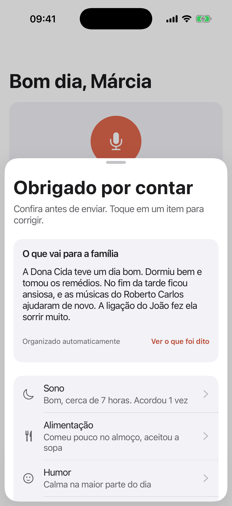
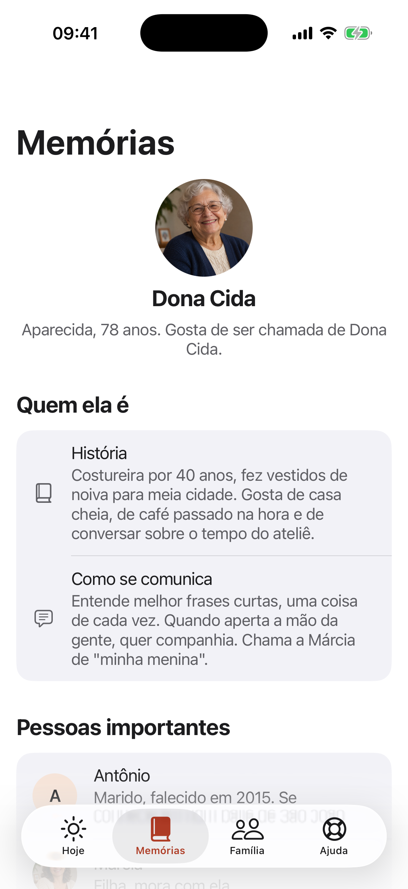
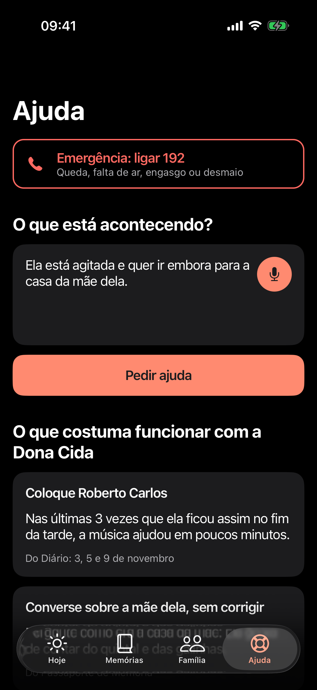
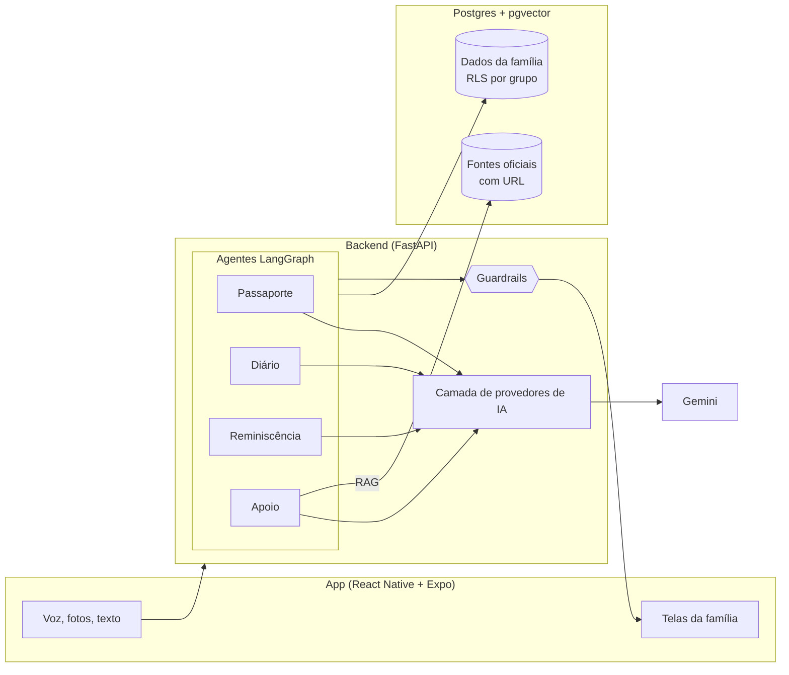

<p align="center">
  
</p>

<p align="center">
  <b>SempreAqui é uma plataforma de IA que aproxima famílias em torno do cuidado de quem vive com Alzheimer, preservando a história da pessoa e garantindo que ninguém cuide sozinho.</b>
</p>

<p align="center">
  <a href="LICENSE">Licença MIT</a> ·
  <a href="docs/etica-e-seguranca.md">Ética e segurança</a> ·
  <a href="docs/avaliacao.md">Avaliação da IA</a> ·
  <a href="docs/roadmap.md">Roadmap</a>
</p>

---

Projeto inscrito no **AI4Good da Brazil Conference 2027 at Harvard & MIT**, tema *"IA que aproxima: unindo pessoas, eliminando barreiras e fortalecendo o pertencimento da sociedade brasileira"*.

## O problema

Cerca de **2 milhões de brasileiros** vivem com demência, e esse número deve **triplicar até 2050**. Quem segura o cuidado é a família:

- **86%** de quem cuida são mulheres, e **45%** têm sintomas de ansiedade ou depressão.
- O cuidado consome em média **mais de 10 horas por dia**.
- O cuidado informal feito pela família responde por **pelo menos 73% dos custos** da demência.

Os números vêm do Relatório Nacional sobre a Demência no Brasil, do Ministério da Saúde. Detalhes e fontes em [docs/problema.md](docs/problema.md).

Por trás dos números, o padrão se repete. Uma filha concentra tudo. Os irmãos que moram longe querem ajudar, mas não sabem como nem o que está acontecendo. Nas consultas, ninguém lembra direito como foram as últimas semanas. E aos poucos a pessoa deixa de ser vista como alguém com história, gostos e jeito próprio, e passa a ser vista só como paciente.

## A solução

O SempreAqui é um app de celular, pensado para ser usado por voz, que faz três coisas: guarda quem a pessoa é, organiza o dia a dia do cuidado e divide esse cuidado com a família.

| Função | O que faz | Onde a IA entra |
|---|---|---|
| **Passaporte de Memória** | A família manda áudios, fotos e textos sobre a pessoa. Sai um perfil com como ela gosta de ser chamada, história, pessoas importantes, rotina, músicas, comidas, o que acalma, o que agita e como se comunica. Gera link somente leitura e PDF de uma página para cuidadores, centro-dia ou hospital. | IA multimodal transcreve e extrai de áudios, fotos e textos soltos um perfil estruturado |
| **Conversas de Reminiscência** | Sessões de 5 a 10 minutos com uma foto, música ou lembrança e perguntas abertas e gentis para a família conduzir. Nunca "você lembra?". Registra como a pessoa reagiu. | Gera roteiros personalizados a partir do Passaporte e aprende com as reações |
| **Diário Inteligente** | Quem cuida grava um áudio contando o dia. Sai um registro de sono, alimentação, humor, agitação, episódios e medicação, um resumo semanal para a família e uma lista objetiva "Para levar na consulta". | Transcreve, extrai campos estruturados e compara com o habitual da própria pessoa |
| **Apoio na Hora Difícil** | Quem cuida descreve a situação ("ela está agitada e quer ir embora") e recebe o que costuma funcionar para aquela pessoa. Dúvidas gerais são respondidas com fontes oficiais e link. Em risco, orienta ligar 192 e avisa a família. | Agente cruza Passaporte e Diário, e RAG sobre fontes oficiais |
| **Rede da Família** | Grupo com papéis, divisão de tarefas (consultas, visitas, cobrir a folga de quem cuida), lembretes e um feed com os resumos. | Os resumos da IA viram o feed que mantém todos por perto |

<p align="center">
  
  
  
  
</p>

<p align="center"><sub>Telas rodando no iPhone (iOS 26). Família fictícia, retratos gerados por IA. Todas as telas, em modo claro e escuro, estão em <a href="design/screens">design/screens</a>.</sub></p>

## Por que IA

Quem cuida não tem tempo de preencher formulário. Tem tempo de mandar um áudio de dois minutos no fim do dia, do mesmo jeito que manda para a irmã no WhatsApp. A IA é o que transforma esse áudio desorganizado em informação útil: um registro estruturado, um resumo carinhoso para quem mora longe, uma comparação com as semanas anteriores e uma lista objetiva para o médico.

Sem IA, o SempreAqui seria mais um app de anotações que ninguém atualiza. Com IA, o esforço de quem cuida continua sendo só falar, e toda a família passa a enxergar o cuidado.

## Princípios

- **A IA não diagnostica e não dá orientação médica.** Ela organiza, resume, aponta mudanças em relação ao habitual da própria pessoa e encaminha. Nunca sugere remédios ou doses, nunca diz que algo é "sinal de piora".
- **Fontes oficiais, sempre com link.** Toda informação geral de saúde vem de materiais do Ministério da Saúde, ABRAz e outras fontes públicas reconhecidas.
- **Guardrails testados, não só pedidos no prompt.** Todo texto voltado à família passa por uma verificação automática. Se a IA errar duas vezes, a família recebe um resumo montado sem IA. Risco sempre gera orientação de ligar 192.
- **LGPD de verdade.** Consentimento explícito por finalidade, dados isolados por grupo familiar no próprio banco (Row Level Security), nada de dado real em logs, exportar e apagar tudo com um toque.
- **Linguagem respeitosa.** "Pessoa que vive com Alzheimer", "quem cuida", "família". Nunca "paciente", "fardo" ou "peso".
- **Acessível para quem está cansada.** Voz como entrada principal, fontes grandes, alto contraste, botões grandes.

Tudo isso está detalhado em [docs/etica-e-seguranca.md](docs/etica-e-seguranca.md).

## Arquitetura



Cada função é um grafo LangGraph com etapas pequenas e verificáveis. O do Diário já funciona: transcreve, extrai um JSON validado com Pydantic, avalia risco, resume e revisa com guardrails. Decisões e detalhes em [docs/arquitetura.md](docs/arquitetura.md).

## Stack

| Camada | Tecnologia |
|---|---|
| App | React Native com Expo (TypeScript) e Expo Router. Roda no celular pelo Expo Go |
| Backend | Python, FastAPI |
| Orquestração de IA | LangGraph, um grafo por função |
| Modelos | Gemini (multimodal, bom com áudio em português), atrás de uma camada de provedores trocável por configuração |
| RAG | Embeddings e pgvector, com fonte e URL em cada trecho |
| Banco | Postgres com Row Level Security por grupo familiar (local via Docker ou Supabase) |
| Qualidade | pytest, ruff, avaliações próprias e CI no GitHub Actions |

## Experimente

**Prova de conceito do Diário** (precisa de uma [chave gratuita do Gemini](https://aistudio.google.com/apikey) e do [uv](https://docs.astral.sh/uv/)):

```bash
cp .env.example .env    # preencha GEMINI_API_KEY
uv sync --project backend
uv run --project backend python poc/diario_poc.py --todos
```

Recebe três áudios fictícios de quem cuida e devolve a transcrição, o registro estruturado e o resumo para a família. Veja [poc/README.md](poc/README.md).

**App** (instale o Expo Go no celular):

```bash
cd app
npm install
npx expo start          # escaneie o QR code com o Expo Go
```

**Ambiente completo** (Postgres com pgvector e API):

```bash
docker compose up
```

**Testes e avaliações:**

```bash
cd backend
uv run pytest
uv run python -m evals.avaliar_guardrails
uv run python -m evals.avaliar_diario
```

## Como medimos a IA

Cada etapa tem métrica e gabarito versionados: taxa de erro de palavras da transcrição, acurácia por campo do Diário, detecção de episódios e de risco, e zero violações de guardrail no texto que a família recebe. O conjunto adversarial de guardrails roda no CI. Metodologia e resultados em [docs/avaliacao.md](docs/avaliacao.md).

## Roadmap até o Demo Day

| Quando | Entrega |
|---|---|
| Fase 0 (inscrição) | PoC do Diário, guardrails com avaliação, app navegável, schema com RLS, documentação |
| Semana 1 | Diário ponta a ponta no celular, linha de base e mudança de padrão, Passaporte de Memória |
| Semana 2 | Conversas de Reminiscência, RAG de fontes oficiais, Apoio na Hora Difícil |
| Semana 3 | Rede da Família, resumo semanal, PDF do Passaporte, exportar e apagar, testes com famílias |

Detalhes em [docs/roadmap.md](docs/roadmap.md).

## Objetivos de Desenvolvimento Sustentável

- **ODS 3, Saúde e bem-estar:** bem-estar de quem cuida, consultas mais bem informadas, informação confiável.
- **ODS 5, Igualdade de gênero:** meta 5.4, valorizar o trabalho de cuidado não remunerado e dividi-lo dentro da família. 86% de quem cuida são mulheres.
- **ODS 10, Redução das desigualdades:** inclusão da pessoa que vive com demência como pessoa, acesso gratuito e por voz.

Mais em [docs/ods.md](docs/ods.md).

## Inspiração

O SempreAqui foi inspirado pelo [AlwaysThere](https://devpost.com/software/alwaysthere), projeto que ajuda famílias a apoiar quem vive com Alzheimer ou demência, especialmente quando moram em outra cidade ou país. Partimos da mesma ideia de manter a família por perto e a levamos para a realidade brasileira, com voz em português, IA no centro de cada função e foco em dividir o cuidado que hoje recai sobre uma pessoa só.

## Como contribuir

Contribuições são muito bem-vindas, de código a revisão de texto e indicação de fontes oficiais. Leia o [guia de contribuição](CONTRIBUTING.md) e o [código de conduta](CODE_OF_CONDUCT.md). Se você cuida ou cuidou de alguém com demência e quer conversar sobre o projeto, abra uma issue. Sua experiência vale mais que qualquer linha de código.

## Licença

[MIT](LICENSE). Projeto pessoal e independente, de código aberto.
