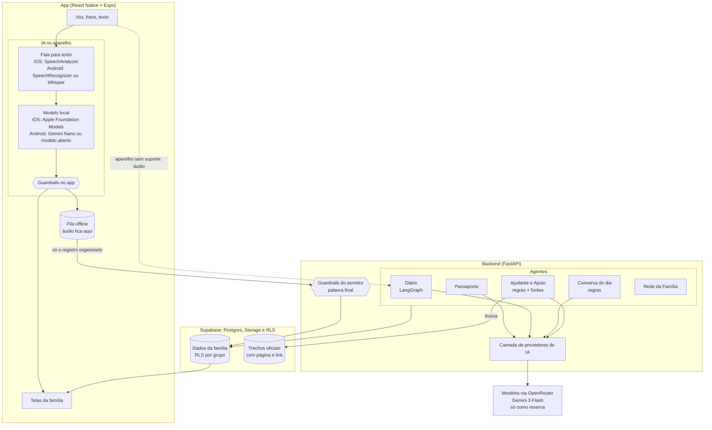

<p align="center">
  
</p>

<p align="center">
  <b>SempreAqui é uma plataforma de IA que aproxima famílias em torno do cuidado de quem vive com Alzheimer, preservando a história da pessoa e garantindo que ninguém cuide sozinho.</b>
</p>

<p align="center">
  <a href="LICENSE">Licença MIT</a> ·
  <a href="docs/etica-e-seguranca.md">Ética e segurança</a> ·
  <a href="docs/avaliacao.md">Avaliação da IA</a> ·
  <a href="docs/roadmap.md">Roadmap</a>
</p>

---

Projeto inscrito no **AI4Good da Brazil Conference 2027 at Harvard & MIT**, tema *"IA que aproxima: unindo pessoas, eliminando barreiras e fortalecendo o pertencimento da sociedade brasileira"*.

## O problema

Cerca de **2 milhões de brasileiros** vivem com demência, e esse número deve **triplicar até 2050**. Quem segura o cuidado é a família:

- **86%** de quem cuida são mulheres, e **45%** têm sintomas de ansiedade ou depressão.
- O cuidado consome em média **mais de 10 horas por dia**.
- O cuidado informal feito pela família responde por **pelo menos 73% dos custos** da demência.

Os números vêm do Relatório Nacional sobre a Demência no Brasil, do Ministério da Saúde. Detalhes e fontes em [docs/problema.md](docs/problema.md).

Por trás dos números, o padrão se repete. Uma filha concentra tudo. Os irmãos que moram longe querem ajudar, mas não sabem como nem o que está acontecendo. Nas consultas, ninguém lembra direito como foram as últimas semanas. E aos poucos a pessoa deixa de ser vista como alguém com história, gostos e jeito próprio, e passa a ser vista só como paciente.

## A solução

O SempreAqui é um app de celular, pensado para ser usado por voz, que faz três coisas: guarda quem a pessoa é, organiza o dia a dia do cuidado e divide esse cuidado com a família.

| Função | O que faz | Onde a IA entra |
|---|---|---|
| **Diário Inteligente** | Quem cuida grava um áudio contando o dia. Sai um registro de sono, alimentação, humor, agitação, episódios e remédios, cada campo corrigível com um toque, um resumo para a família, a semana com o que mudou em relação ao habitual e uma lista "Para levar na consulta" em PDF. Funciona sem internet. | Transcreve e extrai campos estruturados, no próprio iPhone quando dá; aprende com as correções da família |
| **Passaporte de Memória** | Quem ela é, como se comunica, pessoas importantes, rotina, o que acalma, o que agita, músicas, comidas e lembranças com foto. A família conta falando ou escrevendo e confere antes de salvar; o app mostra o que falta. Sai em PDF de uma página e em link somente leitura para cuidador, centro-dia ou hospital. | Separa nas seções o que a família contou; a família marca o que entra |
| **Conversa do dia** | Uma conversa de 5 a 10 minutos, em tela cheia e letra grande, com foto, música no YouTube e perguntas gentis. Muda todo dia, nunca pergunta "você lembra?" e guarda como ela reagiu para escolher as próximas. | Roteiros revisados escolhidos por regras; no iPhone, a IA reescreve as perguntas para ela, com validação |
| **Ajudante** | Um chat para a família: "como ela está?", "como foi a semana?", "o que falta fazer?", "ela está agitada, o que eu faço?". Cada resposta diz de onde veio. Na hora difícil, traz o que costuma funcionar com ela e o que dizem as fontes oficiais; em risco, 192 e aviso à família. Remédio e diagnóstico recebem recusa gentil. | Responde com os dados registrados e trechos oficiais literais; no iPhone, a IA cobre o que as regras não reconhecem, validada pelos guardrails |
| **SUS** | Cartão SUS e UBS de referência no Passaporte, programas do SUS para o Alzheimer, Meu SUS Digital e telefones oficiais. Em emergência, mapa com hospitais, UPAs, UBS e CAPS mais próximos, do cadastro oficial do SUS, com rota e telefone. | Dados abertos do Ministério da Saúde (CNES) e do IBGE; o Ajudante responde sobre o cartão e as unidades perto |
| **Rede da Família** | Convite pelo WhatsApp, papéis, tarefas da semana com "Eu assumo" em um toque e lembrete no celular, feed do que aconteceu com "Obrigado" e avisos urgentes. Cada pessoa com nome e foto. | Os resumos do Diário e as conversas viram o feed que mantém todos por perto |

<p align="center">
  
  
  
  
</p>

<p align="center"><sub>Telas rodando no iPhone (iOS 26). Família fictícia, retratos gerados por IA. Todas as telas estão na <a href="#o-app-tela-por-tela">galeria abaixo</a>.</sub></p>

## O app, tela por tela

Cinco abas: **Hoje**, **Memórias**, **Família**, **Ajudante** e **Ajustes**. Cada tela tem uma ação principal clara; o resto fica em listas e em links no título das seções.

| Hoje | Contar o dia | Relato organizado | Corrigir com um toque |
|---|---|---|---|
|  |  |  |  |
| **Situação de risco** | **Diário** | **Semana e consulta** | **Passaporte de Memória** |
|  |  |  |  |
| **Contar uma memória** | **Lembrança com foto** | **Conversa do dia** | **Como foi a conversa** |
|  |  |  |  |
| **Família** | **Pedir ajuda com uma tarefa** | **Ajudante** | **Ajudante na hora difícil** |
|  |  |  |  |
| **Ajustes** | **Privacidade e dados** | **Primeira abertura** | **Termo em linguagem simples** |
|  |  |  |  |

## Por que IA

Quem cuida não tem tempo de preencher formulário. Tem tempo de mandar um áudio de dois minutos no fim do dia, do mesmo jeito que manda para a irmã no WhatsApp. A IA é o que transforma esse áudio desorganizado em informação útil: um registro estruturado, um resumo carinhoso para quem mora longe, uma comparação com as semanas anteriores e uma lista objetiva para o médico.

Sem IA, o SempreAqui seria mais um app de anotações que ninguém atualiza. Com IA, o esforço de quem cuida continua sendo só falar, e toda a família passa a enxergar o cuidado.

## Princípios

- **A IA não diagnostica e não dá orientação médica.** Ela organiza, resume, aponta mudanças em relação ao habitual da própria pessoa e encaminha. Nunca sugere remédios ou doses, nunca diz que algo é "sinal de piora".
- **Fontes oficiais, sempre com link.** Toda orientação geral é trecho literal de fonte oficial (hoje, o Guia Prático do Cuidador, do Ministério da Saúde), com link para a página. Nada é escrito pela IA.
- **Guardrails testados, não só pedidos no prompt.** Todo texto voltado à família passa por uma verificação automática. Se a IA errar duas vezes, a família recebe um resumo montado sem IA. Risco sempre gera orientação de ligar 192.
- **LGPD de verdade.** Consentimento explícito por finalidade, dados isolados por grupo familiar no próprio banco (Row Level Security), nada de dado real em logs, exportar e apagar tudo com um toque.
- **Linguagem respeitosa.** "Pessoa que vive com Alzheimer", "quem cuida", "família". Nunca "paciente", "fardo" ou "peso".
- **Acessível para quem está cansada.** Voz como entrada principal, fontes grandes, alto contraste, botões grandes, e cada tela com uma ação principal clara.

Tudo isso está detalhado em [docs/etica-e-seguranca.md](docs/etica-e-seguranca.md).

## IA no próprio celular

No iPhone com Apple Intelligence, o SempreAqui **transcreve e organiza o relato dentro do celular**. A nuvem fica só como reserva, para aparelhos sem suporte.

Os ganhos:

- **O áudio nunca sai do celular.** A transcrição e a extração acontecem no aparelho, e só o registro organizado é compartilhado com a família. É a forma mais forte de cumprir a LGPD: minimização de dados (art. 6º, III) e menos dado sensível de saúde (art. 11) trafegando ou guardado por terceiros.
- **Nenhum provedor de IA vê a vida da família.** Sem envio para modelos externos, não há risco de os dados serem usados para treinar modelos nem de vazarem num serviço de fora.
- **Custo de IA zero.** O que mais custa é mandar áudio para um modelo na nuvem. Rodando no aparelho, isso some, e o app pode continuar gratuito para as famílias.
- **Funciona sem internet de verdade.** O resultado aparece na hora, mesmo no interior, no hospital ou com o plano de dados acabado. Quando a conexão volta, o relato sincroniza sozinho.

Como funciona em cada plataforma:

| Etapa | iPhone (construído) | Android (planejado) | Reserva |
|---|---|---|---|
| Transcrição | SpeechAnalyzer do iOS 26, no aparelho | SpeechRecognizer no aparelho (Android 13+) ou Whisper via whisper.cpp | Gemini 3 Flash via OpenRouter |
| Organizar o relato | Apple Foundation Models, com saída presa ao schema do registro | Gemini Nano pelo ML Kit nos aparelhos com suporte; modelo aberto pequeno (Gemma ou Qwen) via llama.cpp com gramática JSON nos demais | Gemini 3 Flash via OpenRouter |
| Guardrails | No app e de novo no backend | No app e de novo no backend | No backend |
| O que sai do celular | Só a transcrição e o registro | Só a transcrição e o registro | O áudio |

Os dois lados usam a mesma interface do módulo nativo (`disponibilidade`, `transcrever`, `gerarRegistro`, `gerarTexto`). Por isso o Android entra sem mudar uma linha do app em TypeScript nem do backend.

- Os guardrails do celular são um espelho dos do backend e passam nos mesmos 53 casos adversariais (`node scripts/guardrails.ts`, no CI).
- Quando o relato sincroniza, o backend confere o resumo de novo e recalcula o risco: a palavra final é sempre do servidor.
- Regras fixas protegem contra o modelo menor: se o relato não fala de remédio, o campo fica "não foi falado", diga o modelo o que disser.
- Correções num relato do celular também não vão para a nuvem: o resumo é reescrito no próprio aparelho.
- Quem cuida pode desligar a IA do celular em Ajustes, Privacidade.

Arquitetura, requisitos, contrato de sincronização, plano do Android e como avaliamos: [docs/ia-no-aparelho.md](docs/ia-no-aparelho.md).

## Integração com o SUS

O cuidado de quem vive com Alzheimer no Brasil passa pelo SUS: o diagnóstico, os remédios, a UBS, a emergência. O SempreAqui liga a família a essa rede pública, que é a parte "pertencimento da sociedade brasileira" do tema.

**Cartão SUS e UBS de referência**
- Ficam no Passaporte de Memória, em "Saúde e SUS".
- O número do Cartão Nacional de Saúde é conferido pelo dígito verificador oficial: 15 dígitos, começando com 1, 2, 7, 8 ou 9, e a soma ponderada múltipla de 11. Número digitado errado não entra.
- Vai para o PDF do passaporte (para o hospital ou o cuidador) e para o PDF "Para levar na consulta". **Nunca aparece no link compartilhado.**
- O Ajudante responde "qual o cartão SUS dela?" com o número e o caminho para o Meu SUS Digital.

**Programas e serviços do SUS** (tela "SUS", em Memórias ou Ajustes; todos os links conferidos no ar)

| Programa ou serviço | Para que serve |
|---|---|
| [Componente Especializado da Assistência Farmacêutica](https://www.gov.br/saude/pt-br/composicao/sectics/daf/ceaf) | Remédios do Alzheimer de graça, com receita e laudo do médico |
| [Protocolo Clínico e Diretrizes Terapêuticas da Doença de Alzheimer](https://www.gov.br/saude/pt-br/assuntos/pcdt/d/doenca-de-alzheimer/view) | O protocolo oficial que orienta diagnóstico e tratamento na rede pública |
| [Melhor em Casa](https://www.gov.br/saude/pt-br/composicao/saes/melhor-em-casa) | Atendimento do SUS em casa, para quem tem dificuldade de sair |
| [Brasil que Cuida](https://www.gov.br/mds/pt-br/acoes-e-programas/brasil-que-cuida) | Política Nacional de Cuidados ([Lei 15.069/2024](https://www.planalto.gov.br/ccivil_03/_ato2023-2026/2024/lei/l15069.htm)): apoio a quem cuida e a quem é cuidado |
| [Meu SUS Digital](https://meususdigital.saude.gov.br) | Cartão SUS digital, carteira de vacinação, exames e histórico de atendimentos |
| [Farmácia Popular](https://www.gov.br/saude/pt-br/composicao/sectics/farmacia-popular) | Remédios de graça ou com desconto em farmácias credenciadas |
| [Vacinação](https://www.gov.br/saude/pt-br/vacinacao) | Calendário e campanhas do Ministério da Saúde |
| [Ouvidoria do SUS](https://www.gov.br/saude/pt-br/canais-de-atendimento/ouvsus) | Reclamações, sugestões e informações (136) |
| Telefones | 192 (SAMU), 136 (Disque Saúde), 100 (violência contra a pessoa idosa) |

**Mapa "Perto de você": hospitais, UPAs, UBS e CAPS**
- Usa os **dados abertos do Cadastro Nacional de Estabelecimentos de Saúde (CNES)**, do Ministério da Saúde, que trazem nome, endereço, telefone, coordenadas, se atende pelo SUS e se funciona 24 horas. Não precisa de cadastro.
- O celular informa a cidade e a posição; o backend acha o município pelo IBGE, busca as unidades do tipo pedido e calcula as mais próximas.
- Três buscas: **Emergência** (UPA, pronto-socorro, hospital, unidade mista), **Postos e UBS** e **CAPS**.
- Em emergência, quando a distância é parecida, vem antes o que é do SUS (não cobra) e o que funciona 24 horas. Hospitais particulares continuam na lista, sem o selo do SUS.
- Como UBS só entram unidades **públicas que atendem pelo SUS**: no cadastro, clínicas particulares às vezes usam o mesmo tipo de unidade.
- Mapa nativo (Apple Maps) e lista com distância, "24 horas" e "Atende pelo SUS". Um toque dá a rota no Mapas ou liga para a unidade.
- Atalhos: "Hospitais e UPAs perto de você" no Hoje, "Hospitais e UPAs perto" quando o Ajudante reconhece risco, e a pergunta "tem hospital perto?" no Ajudante.
- A lista de cada cidade fica guardada no servidor por 7 dias. A primeira busca numa cidade leva alguns segundos; as seguintes são imediatas.

**Privacidade**
- A localização do celular é usada só para calcular a distância e **não é guardada**.
- O SempreAqui **não acessa os sistemas do SUS**: guarda o número que a família digitou, usa dados abertos e aponta para os serviços oficiais.

**Limites que assumimos**
- Algumas coordenadas do próprio CNES estão desatualizadas, e uma unidade pode aparecer mais perto do que está. O app avisa para conferir o endereço antes de sair.
- Ler prontuário, exames ou vacinação direto do SUS exige credenciamento na **RNDS** (Rede Nacional de Dados em Saúde). Por enquanto, o app leva a família ao Meu SUS Digital, onde esses dados já estão. Exportar o resumo da semana no padrão da RNDS está no roadmap.

Código: [backend/core/sus.py](backend/core/sus.py), [app/src/lib/sus.ts](app/src/lib/sus.ts), [app/src/app/sus.tsx](app/src/app/sus.tsx) e [app/src/app/perto.tsx](app/src/app/perto.tsx).

## Arquitetura

O SempreAqui tem dois caminhos de IA. No celular que aguenta, tudo acontece no aparelho e só o resultado organizado sobe. Nos outros, o áudio vai para o backend, que usa modelos na nuvem. Nos dois caminhos, os mesmos guardrails e o mesmo formato de registro.



- **Caminho no aparelho (iPhone com Apple Intelligence, construído):** transcrição, extração estruturada e resumo rodam no celular. Para o backend vai só a transcrição e o registro, e ele reaplica os guardrails e recalcula o risco antes de salvar. Detalhes, requisitos e o plano para Android em [docs/ia-no-aparelho.md](docs/ia-no-aparelho.md).
- **Caminho na nuvem (reserva):** cada função é um grafo LangGraph com etapas pequenas e verificáveis. O do Diário transcreve, extrai um JSON validado com Pydantic, avalia risco, resume e revisa com guardrails.
- **Conversa do dia:** montada sem IA, a partir do Passaporte, com roteiros revisados que mudam todo dia e aprendem com a reação registrada pela família. No iPhone, a IA do aparelho reescreve as perguntas e uma validação barra "lembra", "recorda" e "esqueceu".
- **Ajudante e Apoio:** determinísticos de propósito. Reconhecem a pergunta, respondem com os dados da família e dizem de onde veio; na hora difícil, cruzam Passaporte e Diário e citam trechos oficiais literais. As avaliações medem 100% de recusa médica e de fonte (veja [docs/avaliacao.md](docs/avaliacao.md)).
- **Rede da Família:** convites por código, tarefas, feed e avisos, com o mesmo isolamento por família no banco.

Decisões e detalhes em [docs/arquitetura.md](docs/arquitetura.md).

## Stack

| Camada | Tecnologia |
|---|---|
| App | React Native com Expo (TypeScript), Expo Router, abas nativas do iOS, notificações locais para lembretes e build nativo instalável |
| IA no aparelho, iOS | Módulo nativo em Swift: SpeechAnalyzer (iOS 26) e Apple Foundation Models com geração guiada pelo schema |
| IA no aparelho, Android | Planejado: SpeechRecognizer no aparelho ou Whisper, e Gemini Nano (ML Kit) ou modelo aberto pequeno via llama.cpp |
| Backend | Python, FastAPI |
| Orquestração de IA | LangGraph, um grafo por função |
| Modelos na nuvem | Gemini 3 Flash via OpenRouter (escolhido por benchmark próprio de transcrição), só como reserva e só com provedores que não guardam dados |
| Dados do SUS | Dados abertos do CNES (Ministério da Saúde) para unidades perto, IBGE para o município; mapa nativo com expo-maps e localização com expo-location |
| Fontes oficiais | Acervo de trechos literais do Guia Prático do Cuidador (Ministério da Saúde), com página e link; busca por palavras, explicável e sem custo. pgvector entra quando o acervo crescer |
| Banco | Supabase (Postgres) com Row Level Security por grupo familiar, ou SQLite local |
| Qualidade | pytest, ruff, guardrails iguais no app e no backend checados no CI, avaliações próprias |

## Experimente

Precisa do [uv](https://docs.astral.sh/uv/), do Node 22+ e de uma chave do [OpenRouter](https://openrouter.ai/keys).

**Backend e família de demonstração:**

```bash
cp .env.example .env               # preencha OPENROUTER_API_KEY
bash scripts/instalar-hooks.sh     # bloqueia commits com chaves
cd backend
uv sync
uv run python -m demo.seed         # Dona Isabel, Cláudia e Rafael, com relatos de exemplo
uv run uvicorn api.main:app --host 0.0.0.0 --port 8000
```

**App** (no Expo Go, na mesma rede Wi-Fi do computador):

```bash
cd app
npm install
npx expo start          # escaneie o QR code com o Expo Go
```

O app encontra o backend sozinho, pelo mesmo IP do Metro. No Expo Go tudo funciona, com a IA na nuvem. Para a **IA no próprio celular**, instale o build nativo num iPhone com Apple Intelligence: `npx expo run:ios --device` (com `APPLE_TEAM_ID` no `app/.env`).

**Prova de conceito pela linha de comando:**

```bash
uv run --project backend python poc/diario_poc.py --todos
```

Veja [poc/README.md](poc/README.md).

**Banco:** o projeto usa Supabase (Postgres, pgvector, Storage e RLS). Com as variáveis do Supabase no `.env`, `uv run python -m db.migrar` cria tudo. Sem elas, o backend usa um SQLite local e funciona igual.

**Testes e avaliações:**

```bash
cd backend
uv run pytest
uv run python -m evals.avaliar_guardrails
uv run python -m evals.avaliar_diario
uv run python -m evals.avaliar_apoio      # recusa médica, risco, fontes
uv run python -m evals.comparar_transcricao google/gemini-3-flash-preview
```

Métricas anônimas de uso, incluindo a taxa de correção dos campos da IA: `curl localhost:8000/metricas` ([docs/metricas.md](docs/metricas.md)).

## Como medimos a IA

Cada etapa tem métrica e gabarito versionados: taxa de erro de palavras da transcrição, acurácia por campo do Diário, detecção de episódios e de risco, e zero violações de guardrail no texto que a família recebe. O conjunto adversarial de guardrails roda no CI.

O primeiro benchmark com modelos reais mudou uma decisão: o modelo que usávamos inventava o começo de um relato e perdia uma queda, o que apagaria o alerta de 192. Trocamos para o que transcreve com 3,4% de erro e capta a queda sempre. Na prática, a família também avalia a IA: cada campo corrigido vira dado, e a taxa de correção é acompanhada semana a semana. Metodologia e resultados em [docs/avaliacao.md](docs/avaliacao.md).

## Roadmap até o Demo Day

Trabalhamos em ciclos curtos, cada um entregando uma funcionalidade de ponta a ponta no celular.

| Ciclo | Entrega | Estado |
|---|---|---|
| Fase 0 | Documentação, PoC, guardrails com avaliação, app navegável | concluído |
| 1 | Diário redondo: gravação real, offline, correção com um toque, histórico | concluído |
| 2 | Resumo da semana, mudanças de padrão, lista para a consulta em PDF | construído |
| 3 | Passaporte de Memória por voz, texto e foto, com PDF e link somente leitura | construído |
| 4 | Conversa do dia que muda todo dia, personalizada no celular e que aprende com a reação | construído |
| 5 | Apoio na Hora Difícil com fontes oficiais, 192 e recusa médica medida em 100% | construído |
| 6 | Rede da Família: convite no WhatsApp, "Eu assumo", lembretes e "obrigado" | construído |
| 7 | Polimento, acessibilidade, deploy e roteiro do Demo Day | em andamento: navegação e visual feitos |
| Em paralelo | IA no próprio celular: transcrição e organização do relato sem sair do aparelho | construído no iPhone |
| Em paralelo | Integração com o SUS: Cartão SUS, programas oficiais e mapa de unidades perto | construído |

O que mudou em cada ciclo está no [CHANGELOG](CHANGELOG.md).

Detalhes em [docs/roadmap.md](docs/roadmap.md).

## Objetivos de Desenvolvimento Sustentável

- **ODS 3, Saúde e bem-estar:** bem-estar de quem cuida, consultas mais bem informadas, informação confiável.
- **ODS 5, Igualdade de gênero:** meta 5.4, valorizar o trabalho de cuidado não remunerado e dividi-lo dentro da família. 86% de quem cuida são mulheres.
- **ODS 10, Redução das desigualdades:** inclusão da pessoa que vive com demência como pessoa, acesso gratuito e por voz.

Mais em [docs/ods.md](docs/ods.md).

## Como contribuir

Contribuições são muito bem-vindas, de código a revisão de texto e indicação de fontes oficiais. Leia o [guia de contribuição](CONTRIBUTING.md) e o [código de conduta](CODE_OF_CONDUCT.md). Se você cuida ou cuidou de alguém com demência e quer conversar sobre o projeto, abra uma issue. Sua experiência vale mais que qualquer linha de código.

## Licença

[MIT](LICENSE). Projeto pessoal e independente, de código aberto.
