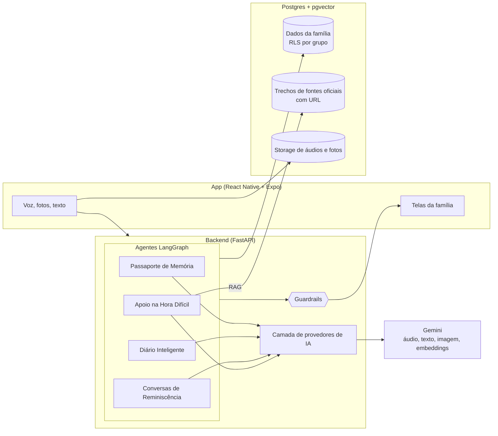
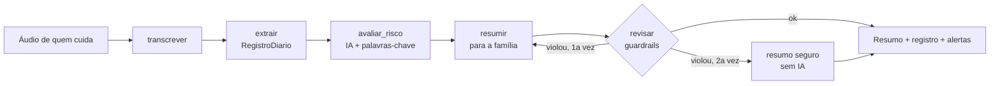

# Arquitetura

## Visão geral



## Fluxo do Diário Inteligente (implementado)



Código: [`backend/agents/diario.py`](../backend/agents/diario.py).

## Decisões

**Um grafo LangGraph por função.** Cada função do produto tem entradas, saídas e riscos diferentes. Grafos separados deixam cada fluxo legível, testável com um provedor falso e avaliável isoladamente. O grafo também deixa explícito onde entram os guardrails, o que é importante para explicar a IA a quem não é técnico.

**IA em etapas pequenas, não um prompt gigante.** Transcrever, extrair e resumir são chamadas separadas. Cada etapa tem um prompt versionado, uma saída verificável e uma métrica própria (WER, acurácia por campo, violações de guardrail). Quando algo dá errado, sabemos onde.

**Saída estruturada validada com Pydantic.** O modelo recebe o JSON Schema gerado do próprio modelo Pydantic e a resposta é validada. Se falhar, o erro volta para o modelo uma vez. O app nunca recebe um JSON que não respeita o contrato.

**Guardrails determinísticos depois da IA.** O prompt pede o comportamento certo, mas não confiamos só nele. Um módulo em Python confere cada texto voltado à família (sem diagnóstico, sem orientação de remédio, sem linguagem desrespeitosa, sem travessão, 192 quando há risco). Se a IA falhar duas vezes, a família recebe um resumo montado sem IA. A detecção de risco combina a IA com palavras-chave, porque um falso negativo ali é muito pior que um falso positivo.

**Camada de provedores.** O código depende de uma interface (`ProvedorIA`) com três métodos: transcrever áudio, gerar texto e gerar estruturado. O Gemini é o padrão por ser multimodal e bom com áudio em português, mas trocar de provedor é configuração. Nos testes usamos um provedor falso, sem rede.

**Prompts versionados em arquivo.** `backend/prompts/<area>/<nome>.v1.md`. Mudança de prompt é nova versão, com avaliação antes e depois. Testes impedem que alguém apague as regras inegociáveis do prompt base.

**Postgres com Row Level Security por grupo familiar.** Todo dado pertence a um grupo. A política de RLS garante no banco, e não só na API, que um membro só enxerga o próprio grupo. A API conecta com um usuário sem privilégio de superusuário para que o RLS valha de fato. Schema em [`backend/db/init/001_schema.sql`](../backend/db/init/001_schema.sql).

**pgvector no mesmo banco.** Para o RAG de fontes oficiais não precisamos de um banco vetorial separado. Cada trecho guarda título, órgão e URL, e a resposta sempre cita o link.

**Expo com Expo Router.** Roda no celular via Expo Go sem build nativo, o que permite testar com famílias desde a primeira semana e fazer o demo ao vivo. A gravação de áudio usa o módulo nativo do Expo.

**docker-compose para o ambiente local.** `docker compose up` sobe Postgres com pgvector e a API. Para o demo, deploy em Railway ou Cloud Run com o mesmo Dockerfile.

## Decisões do Ciclo 1

**O áudio é guardado antes de qualquer IA.** O celular grava, salva o arquivo na pasta do app e só então tenta enviar. O backend guarda o áudio primeiro e processa em segundo plano. Se a IA cair ou ficar sem saldo, nada se perde: o relato fica com uma mensagem humana e um "Tentar de novo".

**IA no próprio celular.** No iPhone com Apple Intelligence, o módulo nativo `app/modules/ia-local` transcreve com o SpeechAnalyzer do iOS 26 e organiza com o modelo local da Apple (Foundation Models), usando geração guiada por um espelho do `RegistroDiario`. O app normaliza o JSON, calcula o risco e escreve o resumo com os guardrails em TypeScript (`src/lib/guardrails.ts`). Só o resultado entra na fila e vai para `POST /diario/relatos/do-aparelho`, onde o backend valida com Pydantic, recalcula o risco e reaplica os guardrails. O áudio fica no celular. No Android, o mesmo módulo tem uma parte em Kotlin (conversão do áudio para o Whisper, memória do aparelho e Gemini Nano pelo ML Kit) e um adaptador em TypeScript (`adaptador.android.ts`) que escolhe o motor: Gemini Nano onde existe, Llama 3.2 3B com 6 GB de RAM ou mais, nuvem nos demais. O Metro só empacota o adaptador no Android, e `react-native.config.js` tira o llama.rn e o whisper.rn do build do iOS. Se a IA local falhar ou o aparelho não tiver suporte, o relato segue pelo caminho da nuvem.

**Fila offline idempotente.** O id do relato nasce no celular. Reenviar o mesmo relato (porque a conexão caiu no meio) nunca duplica nada.

**Progresso real, não um cronômetro.** O grafo do Diário avisa cada etapa concluída (`transcrevendo`, `organizando`, `resumindo`) e o app mostra essa etapa em linguagem humana.

**A família ensina a IA.** Cada correção fica guardada com o valor anterior e o novo. As correções mais recentes da família entram no prompt de extração seguinte (`extracao.v2`), como exemplos de como aquela família fala. A taxa de correção é medida semana a semana.

**Desfazer em vez de confirmar.** Correções e descarte de gravação têm "Desfazer" logo depois. O único "tem certeza?" é para apagar dados.

**Supabase com RLS testado.** Postgres pelo pooler e áudios num bucket privado. As migrações ficam em `backend/db/migrations` e rodam com `uv run python -m db.migrar`. O RLS foi verificado contra o projeto real: com a chave pública, todas as tabelas devolvem zero linhas, a escrita é recusada e os áudios não baixam. O backend filtra por família em toda consulta. Sem Supabase configurado, o mesmo backend usa um SQLite local (`REPOSITORIO=local`), útil para testes e para rodar sem internet.

**Modelo escolhido por benchmark.** O benchmark de transcrição mostrou que o modelo padrão anterior perdia a queda do relato de risco. Escolhemos o modelo pela métrica que importa para a segurança, não pela fama.

## Estrutura do repositório

```
app/          App Expo (telas em src/app, componentes, tema, dados fictícios)
backend/
  api/        FastAPI
  agents/     grafos LangGraph, um por função
  core/       provedores de IA, guardrails, prompts, schemas
  prompts/    prompts versionados
  rag/        fontes oficiais e ingestão
  evals/      gabaritos e scripts de avaliação
  db/         schema SQL com RLS
  tests/      pytest
poc/          prova de conceito da Fase 0
docs/         documentação
design/       logo e assets
```

## Autenticação básica

O app autentica e-mail e senha no Supabase Auth (`signInWithPassword`). O backend continua validando o JWT pelo JWKS e usando `POST /sessao` para localizar ou criar a família. O login reutiliza as tabelas do Supabase Auth; o endpoint de cadastro é descrito abaixo. Não são criadas novas contas anônimas pelo app.

A sessão nativa usa `expo-secure-store`, com renovação automática do cliente Supabase enquanto o app está ativo. O Expo Router protege todas as telas internas até a autenticação e a família estarem prontas. A saída usa escopo local, encerrando a sessão deste dispositivo. Na web a sessão fica em memória.

As cópias offline, filas e o estado de onboarding são identificados por usuário; ao mudar de conta, os estados em memória são reiniciados. Áudios novos têm pasta por conta. Dados locais do fluxo anônimo anterior não são associados automaticamente a outra conta. A implantação deve manter `ACEITAR_X_FAMILIA=0`; `FAMILIA_DEMO_PARA_NOVOS` serve exclusivamente para demonstrações fictícias.

### Cadastro

O cadastro passa por `POST /auth/cadastro`: o servidor valida os campos e o aceite, cria o usuário no Supabase Auth com `email_confirm: true` e não envia e-mail. O app então usa o login por senha já existente. O nome vai em `user_metadata`; a data do servidor e a versão do aceite ficam em `app_metadata`, que o usuário não pode alterar. Não é necessária migração de tabelas. A autorização para dados de saúde continua no onboarding, por finalidade.

A rota administrativa usa somente segredos do backend e não atualiza contas duplicadas. Respostas de validação nunca ecoam os campos do cadastro. O limite de tentativas atual é local ao processo; ao escalar para várias instâncias, deve usar armazenamento compartilhado.
