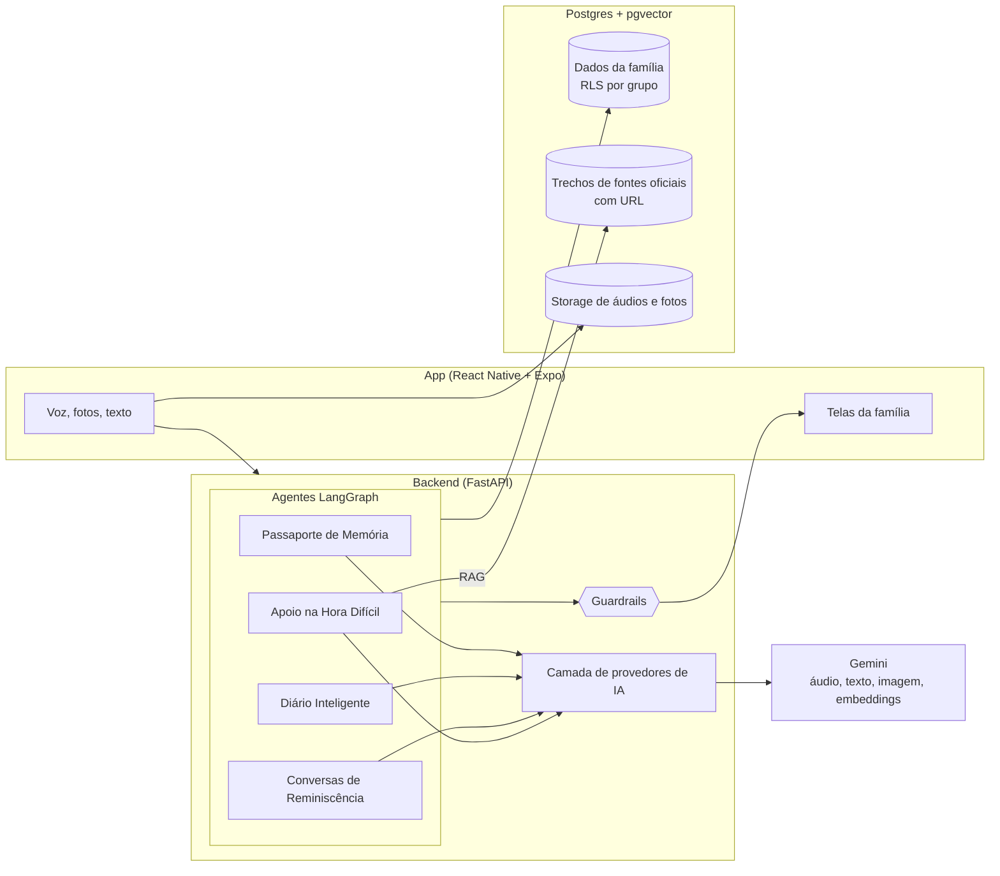
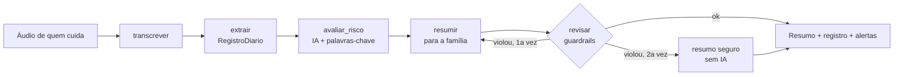

# Arquitetura

## Visão geral



## Fluxo do Diário Inteligente (implementado)



Código: [`backend/agents/diario.py`](../backend/agents/diario.py).

## Decisões

**Um grafo LangGraph por função.** Cada função do produto tem entradas, saídas e riscos diferentes. Grafos separados deixam cada fluxo legível, testável com um provedor falso e avaliável isoladamente. O grafo também deixa explícito onde entram os guardrails, o que é importante para explicar a IA a quem não é técnico.

**IA em etapas pequenas, não um prompt gigante.** Transcrever, extrair e resumir são chamadas separadas. Cada etapa tem um prompt versionado, uma saída verificável e uma métrica própria (WER, acurácia por campo, violações de guardrail). Quando algo dá errado, sabemos onde.

**Saída estruturada validada com Pydantic.** O modelo recebe o JSON Schema gerado do próprio modelo Pydantic e a resposta é validada. Se falhar, o erro volta para o modelo uma vez. O app nunca recebe um JSON que não respeita o contrato.

**Guardrails determinísticos depois da IA.** O prompt pede o comportamento certo, mas não confiamos só nele. Um módulo em Python confere cada texto voltado à família (sem diagnóstico, sem orientação de remédio, sem linguagem desrespeitosa, sem travessão, 192 quando há risco). Se a IA falhar duas vezes, a família recebe um resumo montado sem IA. A detecção de risco combina a IA com palavras-chave, porque um falso negativo ali é muito pior que um falso positivo.

**Camada de provedores.** O código depende de uma interface (`ProvedorIA`) com três métodos: transcrever áudio, gerar texto e gerar estruturado. O Gemini é o padrão por ser multimodal e bom com áudio em português, mas trocar de provedor é configuração. Nos testes usamos um provedor falso, sem rede.

**Prompts versionados em arquivo.** `backend/prompts/<area>/<nome>.v1.md`. Mudança de prompt é nova versão, com avaliação antes e depois. Testes impedem que alguém apague as regras inegociáveis do prompt base.

**Postgres com Row Level Security por grupo familiar.** Todo dado pertence a um grupo. A política de RLS garante no banco, e não só na API, que um membro só enxerga o próprio grupo. A API conecta com um usuário sem privilégio de superusuário para que o RLS valha de fato. Schema em [`backend/db/init/001_schema.sql`](../backend/db/init/001_schema.sql).

**pgvector no mesmo banco.** Para o RAG de fontes oficiais não precisamos de um banco vetorial separado. Cada trecho guarda título, órgão e URL, e a resposta sempre cita o link.

**Expo com Expo Router.** Roda no celular via Expo Go sem build nativo, o que permite testar com famílias desde a primeira semana e fazer o demo ao vivo. A gravação de áudio usa o módulo nativo do Expo.

**docker-compose para o ambiente local.** `docker compose up` sobe Postgres com pgvector e a API. Para o demo, deploy em Railway ou Cloud Run com o mesmo Dockerfile.

## Estrutura do repositório

```
app/          App Expo (telas em src/app, componentes, tema, dados fictícios)
backend/
  api/        FastAPI
  agents/     grafos LangGraph, um por função
  core/       provedores de IA, guardrails, prompts, schemas
  prompts/    prompts versionados
  rag/        fontes oficiais e ingestão
  evals/      gabaritos e scripts de avaliação
  db/         schema SQL com RLS
  tests/      pytest
poc/          prova de conceito da Fase 0
docs/         documentação
design/       logo e assets
```
