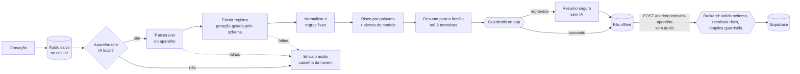

# IA no próprio celular

O relato de quem cuida é o dado mais sensível do SempreAqui: a voz de uma pessoa cansada, contando o dia de alguém que vive com Alzheimer. A melhor forma de proteger esse dado é não mandá-lo para lugar nenhum. Por isso, sempre que o aparelho aguenta, a IA do SempreAqui roda **dentro do celular**.

Estado hoje:
- **iPhone:** construído e testado num iPhone 17 Pro Max.
- **Android:** construído e testado no emulador, com Whisper e um modelo aberto pequeno.
- **Nuvem:** continua como reserva para qualquer aparelho sem suporte.

## Por que isso importa

| | Na nuvem | No celular |
|---|---|---|
| O que sai do aparelho | O áudio inteiro | Só a transcrição e o registro organizado |
| Quem processa a voz | Um provedor de IA externo, mesmo com `data_collection: deny` | Ninguém além do próprio celular |
| Custo por relato | Tokens de áudio e texto pagos a cada relato | Zero |
| Sem internet | O áudio espera na fila | O resultado aparece na hora |
| Escala | Custo cresce com cada família | Custo de IA não cresce |

**LGPD:**
- **Minimização (art. 6º, III):** o áudio, que é o dado mais rico e mais identificável, não é coletado pelo servidor.
- **Dado sensível de saúde (art. 11):** menos dado sensível trafegando e menos operadores envolvidos.
- **Transferência internacional (art. 33):** sem envio a provedores de IA no exterior no caminho principal.

**Inclusão:**
- O app funciona no interior, no hospital ou com o plano de dados no fim.
- O custo zero de IA permite manter o app gratuito para as famílias, que é o que o SempreAqui precisa para chegar a quem cuida sozinho.

## Arquitetura



Princípios:

1. **Uma interface, duas plataformas.** O módulo nativo expõe quatro funções:
   - `disponibilidade()`: o aparelho consegue transcrever e rodar o modelo? Se não, por quê.
   - `transcrever(uri)`: áudio para texto, no aparelho.
   - `gerarRegistro(instrucoes, prompt)`: JSON no formato exato do `RegistroDiario`.
   - `gerarTexto(instrucoes, prompt)`: texto livre, para o resumo.

   Os prompts, a normalização, os guardrails e a sincronização ficam em TypeScript e são os mesmos no iOS e no Android. Trocar de plataforma é trocar só o módulo nativo.
2. **O servidor tem a palavra final.** O app aplica os guardrails para mostrar um resultado seguro na hora, mesmo offline. Quando o relato sincroniza, o backend valida o registro com Pydantic, recalcula o risco por palavras-chave e reaplica os guardrails. Se o resumo violar qualquer regra, ele é trocado pelo resumo seguro montado sem IA.
3. **Falhar para o lado seguro.** Pode acontecer de:
   - o aparelho não ter suporte;
   - o modelo recusar o pedido;
   - a transcrição vir vazia;
   - o JSON vir quebrado.

   Em qualquer desses casos, o relato segue pelo caminho da nuvem, com o mesmo fluxo de antes. Quem cuida nunca fica sem resultado.
4. **Regras fixas onde o modelo pequeno erra.** O modelo do celular é menor que o da nuvem. Onde ele chuta, uma regra determinística corrige. Exemplo real do primeiro teste: o modelo marcou "tomou só parte dos remédios" num relato que não falava de remédio. Agora, se a transcrição não cita remédio, o campo é "não foi falado", diga o modelo o que disser.
5. **A família decide.** Em Família → Privacidade e dados há uma chave "Organizar os relatos aqui no celular", com a explicação de por que ela está indisponível quando for o caso.

## iPhone (construído)

**Requisitos:**
- iOS 26 ou mais novo.
- Aparelho compatível com Apple Intelligence: iPhone 15 Pro, a linha 16 ou mais novo.
- Apple Intelligence ligada nos Ajustes.
- Na primeira transcrição, o iOS baixa o modelo de fala em português uma única vez. Depois funciona sem internet.

**Peças:**

| Etapa | Tecnologia | Onde |
|---|---|---|
| Transcrição | `SpeechAnalyzer` com `SpeechTranscriber` em pt-BR; `DictationTranscriber` se o primeiro não tiver o idioma | [app/modules/ia-local/ios/IaLocalModule.swift](../app/modules/ia-local/ios/IaLocalModule.swift) |
| Extração | Apple Foundation Models (modelo de linguagem da Apple que roda no aparelho), com `@Generable` espelhando o `RegistroDiario` e `@Guide(.anyOf)` limitando cada campo aos valores aceitos | mesmo arquivo |
| Resumo | Foundation Models, texto livre, temperatura baixa e limite de tokens | mesmo arquivo |
| Prompts | Versões compactas dos prompts do backend, porque a janela de contexto é pequena (`extracao.aparelho.v1`) | [app/prompts/diario-aparelho.ts](../app/prompts/diario-aparelho.ts) |
| Orquestração, normalização, regras fixas | TypeScript | [app/src/lib/ia-local.ts](../app/src/lib/ia-local.ts) |
| Guardrails | Espelho de `backend/core/guardrails.py` | [app/src/lib/guardrails.ts](../app/src/lib/guardrails.ts) |
| Fila e sincronização | Só o resultado entra na fila; o áudio fica na pasta do app | [app/src/lib/diario.ts](../app/src/lib/diario.ts) |

**Geração guiada.** O modelo não "escreve um JSON": ele preenche uma estrutura que o próprio sistema garante. Por isso:
- nunca vem um campo fora do formato;
- nunca vem um valor como "mais ou menos" no lugar de `regular`.

O JSON gerado tem os mesmos nomes de campo do schema Pydantic, e o backend valida sem conversão.

**Filtros da Apple.** O modelo da Apple tem filtros de conteúdo próprios e pode recusar relatos de violência ou queda. Nesse caso:
- o registro pode ir pela nuvem;
- o resumo vira o resumo seguro, que já inclui a orientação de ligar 192.

O alerta de risco não depende do modelo: a checagem por palavras-chave roda no app e no backend.

## Android (construído)

Mesma interface do módulo e mesma lógica em TypeScript (prompts, normalização, regras fixas, guardrails, fila). O que muda é o motor:

| Etapa | Tecnologia | Onde |
|---|---|---|
| Converter o áudio | O app grava em m4a; o Whisper só lê WAV de 16 kHz. Um módulo nativo em Kotlin decodifica com o MediaCodec do Android, junta os canais e reamostra para 16 kHz | [app/modules/ia-local/android](../app/modules/ia-local/android) |
| Transcrição | Whisper `small` quantizado (whisper.cpp via whisper.rn), 190 MB | [app/modules/ia-local/adaptador.android.ts](../app/modules/ia-local/adaptador.android.ts) |
| Extração, memória e perguntas | Qwen2.5 1.5B Instruct quantizado (llama.cpp via llama.rn), 1,1 GB, com a saída presa a um JSON Schema que espelha o `RegistroDiario`: o equivalente da geração guiada da Apple | mesmo arquivo |
| Resumo | O mesmo modelo, texto livre, conferido pelos guardrails | mesmo arquivo |

**Download com consentimento.** Os modelos (1,2 GB no total) são baixados uma vez, em Família → Privacidade e dados, de preferência no Wi-Fi, com progresso na tela e retomada se a conexão cair. A versão é fixa (commit do Hugging Face) e o tamanho de cada arquivo é conferido. Dá para apagar a qualquer momento, e os relatos voltam para a nuvem. Até baixar, o app usa a nuvem.

**Quem tem.** Aparelhos com pelo menos 3,5 GB de RAM. Nos demais, a nuvem, com os mesmos guardrails.

**Testar a IA do celular.** Um botão em Privacidade roda um relato fictício já gravado pelo caminho inteiro, sem internet, e mostra a transcrição, o registro, o resumo e o tempo. Serve para conferir o aparelho e para a demonstração.

**O iPhone não carrega nada disso.** O Metro escolhe `adaptador.android.ts` só no Android, e `react-native.config.js` tira o llama.rn e o whisper.rn do build do iOS.

**Primeiros números (emulador Android 16 num Mac com Apple Silicon, só CPU):**
- Relato de 45 segundos com voz natural: transcrição quase perfeita.
- Caminho inteiro, da transcrição ao resumo: cerca de 50 segundos. Num celular intermediário deve ser mais lento.
- Voz muito robótica (a voz "Eddy" do macOS) derruba o Whisper pequeno: a transcrição sai pelo som, ilegível. O Whisper `large-v3-turbo` acerta, mas tem 574 MB e é três vezes mais lento.

**O que o modelo pequeno ainda erra, e como o app se protege:**
- Deixa campos como "não foi falado" mesmo quando o relato fala deles (remédios, cansaço). A família corrige com um toque, e a correção entra no prompt seguinte.
- Às vezes escreve "Não há sinais de alerta" dentro da lista de alertas. O app e o backend descartam frases que negam o alerta.
- Às vezes devolve o relato inteiro no lugar do resumo, ou abre com "Aqui está um resumo". Resumo acima de 500 caracteres é reprovado e refeito; aberturas são removidas; se nada concreto foi registrado, entra o resumo seguro montado sem IA.
- O risco não depende do modelo: a checagem por palavras-chave roda no app e no backend.

**Próximos passos:** Gemini Nano (ML Kit) nos aparelhos que têm, testar um modelo de 3B parâmetros nos celulares com mais memória e medir em celulares reais de faixas diferentes.

## Além do Diário: Passaporte e Conversa de hoje

A mesma IA do celular é usada em mais dois lugares, com as mesmas regras:

| Onde | O que o celular faz | Reserva na nuvem | Proteção |
|---|---|---|---|
| Contar uma memória | Transcreve e separa o relato da família nas seções do Passaporte (`gerarMemoria`, espelho de `MemoriaOrganizada`) | `POST /passaporte/organizar`, sem guardar o áudio | Guardrails de linguagem em cada sugestão; nada entra sem a família marcar |
| Conversa de hoje | Reescreve as perguntas do roteiro revisado pensando na pessoa (`gerarPerguntas`, exatamente 3) | Não precisa: ficam as perguntas revisadas | `validarPerguntas`: nada de "lembra", "recorda", "esqueceu", guardrails, tamanho e formato. Se uma falhar, nenhuma é usada |

Os roteiros revisados vêm do backend (`core/reminiscencia.py`) e funcionam sem IA. A IA do celular só melhora o que já é seguro.

## Contrato de sincronização

`POST /diario/relatos/do-aparelho`, autenticado como as demais rotas:

```json
{
  "id": "uuid gerado no celular",
  "duracao_s": 42.0,
  "gravado_em": "2026-11-10T21:30:00-03:00",
  "transcricao": "texto transcrito no aparelho",
  "registro": { "...": "RegistroDiario completo" },
  "resumo": "resumo escrito no aparelho",
  "modelo": "apple-foundation-models",
  "versao_prompt": "extracao.aparelho.v1"
}
```

- **Idempotente pelo id:** reenviar da fila não duplica.
- **O backend recalcula os alertas:** soma o que o modelo marcou com a checagem por palavras-chave.
- **O backend confere o resumo:** se violar um guardrail ou faltar o 192 num alerta, ele é trocado pelo resumo seguro.
- **Marcação de origem:** o relato fica com `modelo = "aparelho:..."`, e a resposta traz `no_aparelho: true`.
- **Correções nesses relatos não chamam a nuvem:**
  1. O backend grava o resumo seguro na hora.
  2. O celular reescreve o resumo com a IA local e manda só o texto (`PUT /diario/relatos/{id}/resumo`).
  3. O backend confere esse texto de novo.
- **A IA do celular aprende com a família:** as correções recentes (`GET /diario/correcoes`) ficam guardadas no aparelho e entram no prompt de extração, como na nuvem.

## Como avaliamos

A troca de nuvem para aparelho só vale com evidência. Os critérios são os mesmos do Diário na nuvem ([avaliacao.md](avaliacao.md)):

| Critério | Meta | iPhone |
|---|---|---|
| Guardrails do app iguais aos do backend | 100% dos casos adversariais | 53 de 53, no CI |
| Risco detectado nos relatos de risco | 3 de 3 | coberto pela checagem por palavras, independente do modelo; falta medir o modelo |
| Violações de guardrail no texto para a família | zero | garantido pelo resumo seguro; falta medir a taxa de reprovação |
| Acurácia por campo do registro | igual ou próxima da nuvem | a medir |
| Tempo do relato até o resultado | menos de 15 s para 2 min de áudio | a medir |

Primeiro teste real, num iPhone 17 Pro Max: transcrição e organização corretas em todos os campos, exceto o de remédios num dos relatos. Esse erro levou à regra fixa descrita acima.

Próximo passo: rodar o conjunto de avaliação do Diário no próprio aparelho e publicar os números aqui, separados por motor.

## Limitações conhecidas

- **Modelo menor:** o modelo do celular é menor que o da nuvem e erra mais em relatos longos e confusos. A tela mostra a transcrição e cada campo é corrigível com um toque.
- **Contexto curto:** a janela de contexto é pequena, por isso os prompts do aparelho são compactos e só as 6 correções mais recentes entram.
- **Áudio não sincroniza:** o áudio de um relato organizado no celular fica só naquele celular. Outros membros da família veem a transcrição e o registro, não ouvem o áudio. É a escolha certa para privacidade, e a família sabe disso pelo aviso no relato.
- **Android:** o modelo aberto pequeno erra mais que o da Apple em campos do registro; veja a seção do Android.
